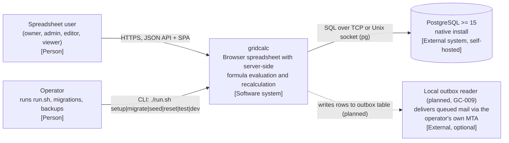
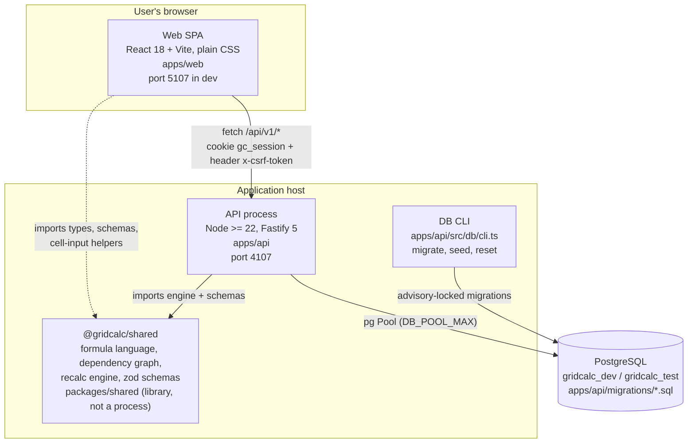
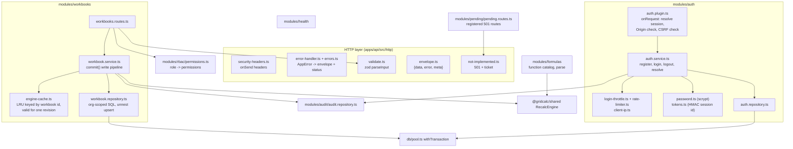
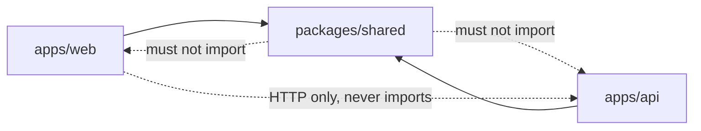
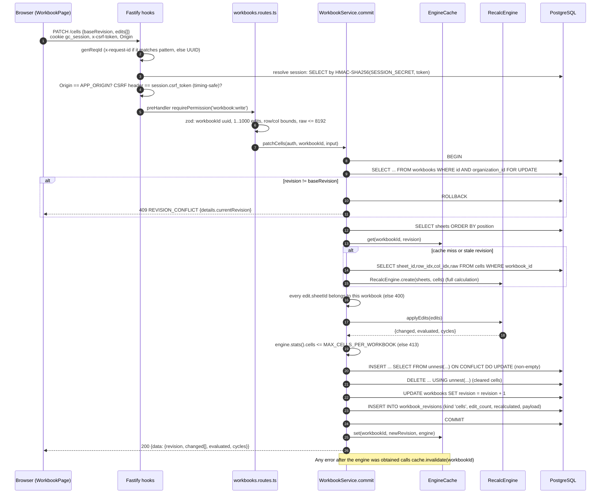

# Architecture overview

gridcalc is a spreadsheet engine that runs in the browser and recalculates on the server. It is
built as a **modular monolith**: one TypeScript codebase in npm workspaces, one Fastify API process,
one React single-page application, and one PostgreSQL database. Nothing at runtime calls a
third-party API or hosted service.

This page describes the system as it is in the repository today and marks clearly what is
planned. About 10% of the backlog (178 of 1764 estimated hours, milestones M0 and M1) is
implemented. Everything labelled _planned_ has a ticket in
[docs/planning/backlog.md](../planning/backlog.md) and does not exist yet.

Related documents:

- [Quality attributes](quality-attributes.md): measurable targets and how they are verified
- [System design](../design/system-design.md): state machines, sequences and algorithms
- [Data model](../design/data-model.md): current and target schema
- [Architecture decision records](../adr/README.md)

---

## 1. C4 level 1: system context

The only runtime dependency outside the Node process is PostgreSQL. Email-style notifications
(verification, invitations, password reset) are planned to be written to an `outbox` table
(GC-009, GC-016, GC-018) so that delivery stays an operator concern, not an outbound API call from
the application.

## 2. C4 level 2: containers

| Container      | Technology                   | Responsibility                                                                                                     | Source                |
| -------------- | ---------------------------- | ------------------------------------------------------------------------------------------------------------------ | --------------------- |
| Web SPA        | React 18, React Router, Vite | Login/register, workbook list, virtualized grid, formula bar, sheet tabs, planned-section placeholders             | `apps/web/src`        |
| API            | Fastify 5, pg, zod, pino     | Auth and sessions, RBAC, tenancy, workbook persistence, the single write pipeline, 501 stubs for pending endpoints | `apps/api/src`        |
| Shared library | TypeScript, zod              | Tokenizer, Pratt parser, evaluator, 43 functions, dependency graph, `RecalcEngine`, request schemas, wire DTOs     | `packages/shared/src` |
| DB CLI         | Node script                  | Forward-only migration runner with checksums and advisory lock, seed, reset                                        | `apps/api/src/db`     |
| PostgreSQL     | PostgreSQL 15+ (native)      | Durable state: tenancy, sessions, audit, workbooks, sheets, sparse cells, revision log                             | `apps/api/migrations` |

## 3. C4 level 3: API components

The composition root is `apps/api/src/app.ts` (`buildApp`). It registers, in order: cookie
parsing, security headers, error handling, the auth hook, health, auth, formula, workbook and
pending routes. The `EngineCache` is constructed once per process with `ENGINE_CACHE_SIZE`
entries (default 16).

## 4. Module boundaries

| Boundary                      | Owns                                                                                                                               | Must not                                                                                                                      |
| ----------------------------- | ---------------------------------------------------------------------------------------------------------------------------------- | ----------------------------------------------------------------------------------------------------------------------------- |
| `packages/shared/src/formula` | Lexing, parsing, printing, coercion, evaluation, the function registry, static precedent extraction, cell-input classification     | Touch I/O, the clock, randomness or any workbook store; it reads cells only through `EvaluationContext`                       |
| `packages/shared/src/graph`   | `DependencyGraph`, `RangeIndex`, `CellKey` encoding, dirty-set BFS, Tarjan ordering                                                | Know about formulas' syntax (it receives already-extracted cell and range precedents)                                         |
| `packages/shared/src/engine`  | `RecalcEngine`: the per-workbook cell store, sheet-name binding, deferred binding, incremental and full recalculation              | Persist anything; return mutable internals (outputs are frozen `ComputedCell`s)                                               |
| `packages/shared/src/api`     | zod request schemas (`patchCellsSchema`, `MAX_EDITS_PER_REQUEST = 1000`, ...), `CellValueDto`, the envelope and `ERROR_CODES_HTTP` | Depend on Fastify or React                                                                                                    |
| `apps/api/src/modules/*`      | One folder per feature: routes -> service -> repository. Repositories take `organization_id` on every tenant query (ADR-0005)      | Reach into another module's repository directly (cross-module calls go through exported functions such as `recordAuditEvent`) |
| `apps/api/src/http`           | Envelope, error mapping, input validation, headers, 501 helper                                                                     | Contain business rules                                                                                                        |
| `apps/web/src`                | Pages, the grid, client-side cell cache (`cell-store.ts`, immutable `Map` copies), keyboard model, API client                      | Evaluate formulas authoritatively; the server's values are the source of truth (ADR-0008)                                     |

## 5. Request lifecycle: `PATCH /api/v1/workbooks/{workbookId}/cells`

Notes:

- The response carries only cells whose stored value changed plus every edited cell, not the whole
  sheet. The client merges them with `applyChanges` into a new `Map` (no in-place mutation).
- On `409` the web client reloads the active sheet window and asks the user to re-apply the edit.
  Automatic merge is planned with collaboration (GC-089, ADR-0017).
- `POST /sheets` uses the same `commit()` with `baseRevision = null` (no stale check), and returns
  `409 CONFLICT` when a sheet with the same case-insensitive name exists.

## 6. Cross-cutting concerns

| Concern             | Current implementation                                                                                                                                                                                          | Planned                                                              |
| ------------------- | --------------------------------------------------------------------------------------------------------------------------------------------------------------------------------------------------------------- | -------------------------------------------------------------------- |
| Configuration       | `apps/api/src/config/env.ts`: zod schema, fail-fast with a list of problems; production refuses `COOKIE_SECURE=false` and an unset `TRUST_PROXY`. Local defaults in `/.env.example`                             | -                                                                    |
| Logging             | pino through Fastify, level `LOG_LEVEL`; redacts `cookie`, `authorization`, `x-csrf-token` request headers and `set-cookie`                                                                                     | Recalc latency histograms on `/api/v1/metrics` (GC-101)              |
| Request correlation | `x-request-id` accepted when it matches `^[A-Za-z0-9._-]{8,64}$`, otherwise a UUID; echoed in responses and stored in `audit_events.request_id`                                                                 | -                                                                    |
| Error model         | `AppError(code)` mapped through `ERROR_CODES_HTTP`; every response uses `{data, error, meta}`                                                                                                                   | -                                                                    |
| Validation          | zod schemas from `@gridcalc/shared` on every body, param and query                                                                                                                                              | -                                                                    |
| Authentication      | Opaque session token in `gc_session` (HttpOnly, SameSite=Lax); DB key is its HMAC; `last_seen_at` touched at most once per minute                                                                               | Session list and revoke (GC-019)                                     |
| CSRF / cross-site   | Per-session token mirrored in readable `gc_csrf` cookie and required in `x-csrf-token` on mutating requests; Origin allow-list on all mutating requests (login/register exempt from CSRF, still Origin-checked) | Web CSP and dependency audit gate (GC-106)                           |
| Abuse control       | `LoginThrottle` (per-IP window, distinct-emails-per-IP cap, per-email progressive backoff), per-IP registration window; in-memory                                                                               | Postgres counters for multi-instance (GC-008)                        |
| Authorization       | Org membership role -> permission list (`permissions.ts`); route `preHandler` guards                                                                                                                            | Workbook ACL overriding org role (GC-098), protected ranges (GC-100) |
| Tenancy             | Every workbook query filters `organization_id` from the session                                                                                                                                                 | -                                                                    |
| Audit               | `recordAuditEvent` inside the same transaction as the change (`organization.registered`, `session.created`, `session.revoked`, `workbook.created`, `sheet.created`)                                             | Search API and viewer (GC-090)                                       |
| Security headers    | `nosniff`, `X-Frame-Options: DENY`, `no-referrer`, CORP same-origin, `default-src 'none'` CSP, `no-store`                                                                                                       | -                                                                    |
| Resource limits     | Body 4 MiB, 1000 edits/request, 8192 chars/cell, 200,000 cells/workbook, 250,000-cell read window, 2,000,000-cell evaluated range, parser depth 64, 255 args                                                    | Worker-thread recalc with time budget (GC-037)                       |
| Health              | `/api/v1/health/live`, `/api/v1/health/ready` (counts `schema_migrations`, 503 when unreachable)                                                                                                                | -                                                                    |

## 7. What exists versus what is planned

| Area                           | Exists (M0, M1)                                                                                                                      | Planned (ticket, milestone)                                                                                                                                                         |
| ------------------------------ | ------------------------------------------------------------------------------------------------------------------------------------ | ----------------------------------------------------------------------------------------------------------------------------------------------------------------------------------- |
| Formula language               | Tokenizer, Pratt parser, printer, evaluator, coercion, 43 functions, 9 error codes                                                   | Date/time (GC-024), lookup v2 (GC-025), text v2 (GC-026), math v2 (GC-027), named ranges (GC-028), `A:A`/3D refs (GC-029), dynamic arrays and spill (GC-034), locale input (GC-036) |
| Recalculation                  | Dependency graph, column-bucketed range index, incremental recalc, Tarjan ordering, `#CYCLE!`, deferred sheet binding, property test | Volatile/dynamic refs (GC-033), worker thread (GC-037), engine snapshots (GC-038), interval tree (GC-047), iterative calc (GC-048), tracing (GC-049)                                |
| Persistence and API            | Workbooks, sheets, sparse cells, revision log, batch PATCH, row lock + revision, LRU engine cache                                    | Rename/delete/duplicate (GC-043), sheet management (GC-044), comments (GC-046)                                                                                                      |
| Grid UI                        | Virtualized DOM grid, formula bar, sheet tabs, keyboard navigation                                                                   | Autocomplete (GC-035), resize (GC-053), range selection (GC-054), freeze panes (GC-055), canvas renderer (GC-056), accessibility audit (GC-058)                                     |
| Structure, formatting, editing | -                                                                                                                                    | GC-060 to GC-063, GC-064 to GC-068, GC-070 to GC-076                                                                                                                                |
| Analysis                       | -                                                                                                                                    | Pivots (GC-077 to GC-079), charts (GC-080 to GC-082)                                                                                                                                |
| Import/export                  | -                                                                                                                                    | CSV (GC-083, GC-084), XLSX-lite (GC-085, GC-086), job runner (GC-087)                                                                                                               |
| Collaboration                  | -                                                                                                                                    | WebSocket gateway (GC-088), LWW with revision vectors (GC-089), presence (GC-091), offline queue (GC-092), LISTEN/NOTIFY (GC-093)                                                   |
| History and sharing            | Append-only `workbook_revisions`                                                                                                     | Timeline (GC-094), versions (GC-095), cell history (GC-096), compaction (GC-097), ACL (GC-098), share links (GC-099), protection (GC-100)                                           |
| Operations                     | `run.sh`, CI on native runner PostgreSQL, readiness                                                                                  | Metrics (GC-101), performance harness (GC-102), backup drill (GC-103), org export/deletion (GC-104), E2E in CI (GC-105), security gates (GC-106)                                    |

Every pending HTTP operation is already registered in
`apps/api/src/modules/pending/pending.routes.ts` and answers `501 NOT_IMPLEMENTED` with its
ticket id (after authentication, except the two password-reset routes).
