# Data model

PostgreSQL (15 or newer) is the only store. This document shows the **target** schema for the
whole backlog, distinguishes what exists from what is planned, and explains each table. The
existing part mirrors `apps/api/migrations/0001_foundation.sql` and
`apps/api/migrations/0002_workbooks_and_cells.sql` exactly; if this page and the SQL disagree,
the SQL wins.

Conventions:

- Primary keys are `uuid DEFAULT gen_random_uuid()` unless the table is a log (identity `bigint`)
  or keyed by a natural composite.
- Timestamps are `timestamptz`, default `now()`.
- Every tenant-owned row reaches `organizations` through a foreign key, and every repository query
  filters by `organization_id` (ADR-0005).
- Cell coordinates are zero-based: `row_idx` 0..1,048,575, `col_idx` 0..16,383 (`A1` is 0,0).
- Ranges in planned tables use the same four integers as `RangeAddress` in
  `packages/shared/src/formula/references.ts`: `top_row`, `left_col`, `bottom_row`, `right_col`
  (inclusive).
- The migration runner keeps its own bookkeeping table `schema_migrations(name, checksum,
applied_at)`, created by `apps/api/src/db/migrate.ts`, not by a migration file.

## 1. Target ERD

Entities whose first attribute comment says `planned` do not exist yet. The comment names the
ticket that adds them.

```mermaid
erDiagram
    organizations ||--o{ memberships : has
    users ||--o{ memberships : has
    users ||--o{ sessions : owns
    organizations ||--o{ sessions : scopes
    organizations ||--o{ audit_events : records
    users |o--o{ audit_events : acts
    organizations ||--o{ workbooks : owns
    users |o--o{ workbooks : creates
    workbooks ||--o{ sheets : contains
    sheets ||--o{ cells : stores
    workbooks ||--o{ cells : denormalizes
    workbooks ||--o{ workbook_revisions : logs
    users |o--o{ workbook_revisions : acts

    workbooks ||--o{ named_ranges : defines
    sheets |o--o{ named_ranges : scopes
    sheets ||--o{ sheet_dimensions : sizes
    sheets ||--o{ style_runs : formats
    cell_styles ||--o{ style_runs : applies
    workbooks ||--o{ cell_styles : interns
    sheets ||--o{ merges : merges
    sheets ||--o{ conditional_formats : highlights
    sheets ||--o{ validations : validates
    sheets ||--o| sheet_filters : filters
    sheets ||--o{ filter_views : views
    users ||--o{ filter_views : owns
    workbooks ||--o{ comments : discusses
    comments |o--o{ comments : replies
    users ||--o{ comments : writes
    workbooks ||--o{ workbook_acl : grants
    users ||--o{ workbook_acl : receives
    workbooks ||--o{ share_links : exposes
    workbooks ||--o{ protected_ranges : protects
    workbooks ||--o{ workbook_versions : names
    workbooks ||--o{ workbook_snapshots : snapshots
    workbooks ||--o| engine_snapshots : warms
    workbooks ||--o{ pivots : summarizes
    workbooks ||--o{ charts : plots
    organizations ||--o{ jobs : queues
    jobs ||--o| imports : runs
    organizations ||--o{ outbox : sends
    users ||--o{ email_verifications : verifies
    organizations ||--o{ invitations : invites
    users ||--o{ password_resets : resets

    organizations {
        uuid id PK
        text name "2..120 chars"
        timestamptz created_at
        jsonb settings "planned GC-014"
    }
    users {
        uuid id PK
        text email UK "lower-case, <= 254"
        text display_name "1..120"
        text password_hash "scrypt$N$r$p$salt$hash"
        timestamptz created_at
        timestamptz last_login_at
        timestamptz email_verified_at "planned GC-009"
    }
    memberships {
        uuid organization_id PK, FK
        uuid user_id PK, FK
        text role "owner|admin|editor|viewer"
        timestamptz created_at
    }
    sessions {
        text id PK "HMAC-SHA256(SESSION_SECRET, token)"
        uuid user_id FK
        uuid organization_id FK
        text csrf_token
        text user_agent
        inet ip_address
        timestamptz created_at
        timestamptz last_seen_at
        timestamptz expires_at
    }
    audit_events {
        bigint id PK "identity"
        uuid organization_id FK
        uuid actor_user_id FK "SET NULL"
        text action
        text target_type
        text target_id
        jsonb metadata
        text request_id
        timestamptz created_at
    }
    workbooks {
        uuid id PK
        uuid organization_id FK
        text name "1..200"
        bigint revision ">= 0, starts at 1"
        uuid created_by FK "SET NULL"
        timestamptz created_at
        timestamptz updated_at
        timestamptz deleted_at "soft delete"
    }
    sheets {
        uuid id PK
        uuid workbook_id FK
        text name "1..100, unique per workbook (ci)"
        integer position "unique per workbook"
        integer row_count "default 100000"
        integer col_count "default 52"
        timestamptz created_at
        boolean hidden "planned GC-044"
    }
    cells {
        uuid sheet_id PK, FK
        integer row_idx PK
        integer col_idx PK
        uuid workbook_id FK
        text raw "non-empty, <= 8192"
        text value_type "empty|number|string|boolean|error"
        jsonb value "CellValueDto"
        bigint updated_revision
        timestamptz updated_at
    }
    workbook_revisions {
        uuid workbook_id PK, FK
        bigint revision PK
        uuid actor_user_id FK "SET NULL"
        text kind "cells|sheet.created|workbook.created"
        integer edit_count
        integer recalculated
        jsonb payload
        timestamptz created_at
        jsonb inverse "planned GC-070"
        text client_id "planned GC-089"
    }

    named_ranges {
        uuid id PK "planned GC-028"
        uuid workbook_id FK
        uuid scope_sheet_id FK "null = workbook scope"
        text name "unique per scope (ci)"
        text definition "formula text, e.g. Data!$A$1:$A$100"
        timestamptz created_at
    }
    sheet_dimensions {
        uuid sheet_id PK, FK "planned GC-053, GC-063"
        text axis PK "row|col"
        integer idx PK
        integer size_px
        boolean hidden
        smallint outline_level
    }
    cell_styles {
        uuid id PK "planned GC-064, GC-065"
        uuid workbook_id FK
        text hash UK "content hash, interned"
        jsonb style "font, fill, borders, alignment"
        text number_format "format code"
    }
    style_runs {
        uuid sheet_id PK, FK "planned GC-064"
        integer col_idx PK
        integer start_row PK
        integer end_row
        uuid style_id FK
    }
    merges {
        uuid id PK "planned GC-068"
        uuid sheet_id FK
        integer top_row
        integer left_col
        integer bottom_row
        integer right_col
    }
    conditional_formats {
        uuid id PK "planned GC-066"
        uuid sheet_id FK
        jsonb ranges "list of rectangles"
        text rule_type "cellIs|formula|colorScale|dataBar"
        jsonb rule
        jsonb style
        integer priority
    }
    validations {
        uuid id PK "planned GC-067"
        uuid sheet_id FK
        jsonb ranges
        text rule_type "list|range|number|custom"
        jsonb rule
        text error_message
    }
    sheet_filters {
        uuid sheet_id PK, FK "planned GC-075"
        integer top_row
        integer left_col
        integer bottom_row
        integer right_col
        jsonb criteria "per column"
    }
    filter_views {
        uuid id PK "planned GC-076"
        uuid sheet_id FK
        uuid user_id FK
        text name
        jsonb criteria
    }
    comments {
        uuid id PK "planned GC-046"
        uuid workbook_id FK
        uuid sheet_id FK
        integer row_idx
        integer col_idx
        uuid parent_id FK "thread root"
        uuid author_id FK
        text body "<= 10000"
        timestamptz resolved_at
        timestamptz created_at
    }
    workbook_acl {
        uuid workbook_id PK, FK "planned GC-098"
        uuid user_id PK, FK
        text role "owner|editor|commenter|viewer"
        uuid granted_by FK
        timestamptz created_at
    }
    share_links {
        uuid id PK "planned GC-099"
        uuid workbook_id FK
        text token_hash UK "HMAC of link token"
        text role "viewer"
        timestamptz expires_at
        timestamptz revoked_at
        uuid created_by FK
    }
    protected_ranges {
        uuid id PK "planned GC-100"
        uuid workbook_id FK
        uuid sheet_id FK "whole sheet when range null"
        jsonb range
        jsonb editors "user ids allowed to edit"
        text description
    }
    workbook_versions {
        uuid id PK "planned GC-095"
        uuid workbook_id FK
        bigint revision "points into workbook_revisions"
        text name
        uuid created_by FK
        timestamptz created_at
    }
    workbook_snapshots {
        uuid workbook_id PK, FK "planned GC-097"
        bigint revision PK
        bytea cells "compressed raw cell dump"
        timestamptz created_at
    }
    engine_snapshots {
        uuid workbook_id PK, FK "planned GC-038"
        bigint revision
        integer format_version
        bytea graph "serialized precedents and values"
        timestamptz created_at
    }
    pivots {
        uuid id PK "planned GC-077"
        uuid workbook_id FK
        jsonb source "sheet id + rectangle"
        jsonb definition "rows, columns, values, filters"
        uuid output_sheet_id FK
        bigint refreshed_revision
    }
    charts {
        uuid id PK "planned GC-080"
        uuid workbook_id FK
        uuid sheet_id FK "anchor sheet"
        text chart_type "bar|line|area|pie|scatter"
        jsonb series "range bindings"
        jsonb layout "anchor cell, size, titles"
    }
    jobs {
        bigint id PK "planned GC-087"
        uuid organization_id FK
        text kind "import|export|org_export"
        text state "queued|running|succeeded|failed"
        integer attempts
        timestamptz run_after
        timestamptz locked_at
        jsonb result
        timestamptz created_at
    }
    imports {
        uuid id PK "planned GC-083, GC-085"
        bigint job_id FK
        uuid workbook_id FK "target, null until created"
        text format "csv|xlsx"
        bytea file "uploaded bytes, size-capped"
        jsonb report "rows read, warnings"
    }
    outbox {
        bigint id PK "planned GC-009"
        uuid organization_id FK
        text kind "verify_email|invitation|password_reset"
        text recipient
        jsonb payload
        timestamptz created_at
        timestamptz delivered_at
    }
    email_verifications {
        text token_hash PK "planned GC-009"
        uuid user_id FK
        timestamptz expires_at
        timestamptz used_at
    }
    invitations {
        uuid id PK "planned GC-016"
        uuid organization_id FK
        text email
        text role
        text token_hash UK
        uuid invited_by FK
        timestamptz expires_at
        timestamptz accepted_at
    }
    password_resets {
        text token_hash PK "planned GC-018"
        uuid user_id FK
        timestamptz expires_at
        timestamptz used_at
    }
    login_throttle {
        text key PK "planned GC-008; ip:<norm> or email:<addr>"
        integer failures
        timestamptz window_started_at
        timestamptz locked_until
        timestamptz updated_at
    }
```

## 2. Existing tables

### 2.1 Tenancy and identity (0001)

| Table           | Purpose                                                      | Key constraints and indexes                                                                                                                                                                   |
| --------------- | ------------------------------------------------------------ | --------------------------------------------------------------------------------------------------------------------------------------------------------------------------------------------- |
| `organizations` | Tenant root. Created by registration together with its owner | `name` length 2..120                                                                                                                                                                          |
| `users`         | Global identity; one row per email                           | `users_email_key` unique on `email`; check `email = lower(email)` and length <= 254; `password_hash` in the `scrypt$N$r$p$salt$hash` format of `password.ts`                                  |
| `memberships`   | User's role in an organization                               | PK `(organization_id, user_id)`; `role IN ('owner','admin','editor','viewer')`; `memberships_user_idx` for "my organizations"; both FKs cascade                                               |
| `sessions`      | Server-side sessions                                         | PK `id` is HMAC-SHA256 of the cookie token (raw token never stored); `csrf_token` per session; `sessions_user_idx`, `sessions_expires_idx`; bound to one organization                         |
| `audit_events`  | Append-only security and change log                          | identity `bigint` PK; `actor_user_id ON DELETE SET NULL` keeps history after user deletion; `audit_events_org_created_idx (organization_id, created_at DESC)` for the planned search (GC-090) |

### 2.2 Workbooks (0002)

| Table                | Purpose                               | Key constraints and indexes                                                                                                                                                                                                                                                                                                        |
| -------------------- | ------------------------------------- | ---------------------------------------------------------------------------------------------------------------------------------------------------------------------------------------------------------------------------------------------------------------------------------------------------------------------------------- |
| `workbooks`          | Workbook header and concurrency token | `revision bigint >= 0`, set to 1 at creation by `insertWorkbook` and incremented by each commit; `deleted_at` reserved for soft delete (GC-043); partial index `workbooks_org_updated_idx (organization_id, updated_at DESC) WHERE deleted_at IS NULL` serves the list endpoint                                                    |
| `sheets`             | Ordered sheets of a workbook          | `sheets_workbook_name_key` unique on `(workbook_id, lower(name))` mirrors the engine's case-insensitive sheet lookup; `sheets_workbook_position_key` unique on `(workbook_id, position)`; `row_count` default 100,000 (max 1,048,576), `col_count` default 52 (max 16,384)                                                         |
| `cells`              | Sparse cell store (ADR-0003)          | PK `(sheet_id, row_idx, col_idx)` serves window reads `row_idx BETWEEN .. AND col_idx BETWEEN ..` and upserts; `cells_workbook_idx (workbook_id)` serves engine rebuild; `raw <> ''` (empty cells have no row) and `length(raw) <= 8192`; `value_type`/`value` hold the last computed `CellValueDto` so reads never run the engine |
| `workbook_revisions` | Append-only log of committed batches  | PK `(workbook_id, revision)`; `kind IN ('cells','sheet.created','workbook.created')`; `payload` holds the edits (`sheetId,row,col,raw`) or sheet info; `recalculated` = formulas evaluated                                                                                                                                         |

Notes on `cells`:

- `workbook_id` is denormalized from `sheets` so that rebuilding an engine is a single indexed
  scan (`SELECT ... FROM cells WHERE workbook_id = $1`) with no join.
- `value` stores the full DTO, for example `{"type":"error","value":"#DIV/0!","message":"Division by zero"}`.
  `value_type` duplicates `value->>'type'` for cheap filtering and a check constraint.
- Writes are two set-based statements per commit: `INSERT ... SELECT FROM unnest(uuid[], int[],
int[], text[], text[], jsonb[]) ON CONFLICT (sheet_id, row_idx, col_idx) DO UPDATE` and
  `DELETE ... USING unnest(...)` for cleared cells (`workbook.repository.ts`, `persistCells`).
- Only cells whose value changed are rewritten, so `updated_revision` tells which revision last
  changed a cell's raw content or computed value.

## 3. Planned tables

| Table                                                      | Ticket                 | Milestone | Notes                                                                                                                                                                                                          |
| ---------------------------------------------------------- | ---------------------- | --------- | -------------------------------------------------------------------------------------------------------------------------------------------------------------------------------------------------------------- |
| `named_ranges`                                             | GC-028                 | M2        | Unique `(workbook_id, coalesce(scope_sheet_id, '00000000-...'), lower(name))`; `definition` parsed by the formula parser and bound like a precedent; rewritten by GC-060/GC-061                                |
| `sheet_dimensions`                                         | GC-053, GC-063         | M3        | Only non-default rows/columns are stored; PK `(sheet_id, axis, idx)`                                                                                                                                           |
| `cell_styles`, `style_runs`                                | GC-064, GC-065         | M3        | Styles are interned per workbook by content hash; runs are per column, `[start_row, end_row]` non-overlapping, so a styled column of 100,000 rows is one row. Index `(sheet_id, col_idx, start_row)` is the PK |
| `merges`                                                   | GC-068                 | M3        | Exclusion constraint on `int4range` boxes per sheet (planned) to forbid overlaps                                                                                                                               |
| `sheets.hidden` (column)                                   | GC-044                 | M3        | Hide/unhide sheets                                                                                                                                                                                             |
| `sheet_filters`                                            | GC-075                 | M4        | One active filter per sheet                                                                                                                                                                                    |
| `workbook_revisions.inverse` (column)                      | GC-070                 | M4        | Inverse ops for server-side undo                                                                                                                                                                               |
| `jobs`, `imports`                                          | GC-087, GC-083, GC-085 | M5        | Queue claimed with `SELECT ... FOR UPDATE SKIP LOCKED` ordered by `run_after`; index `(state, run_after)`; uploaded bytes kept in `bytea` with a size cap, no external object store                            |
| `engine_snapshots`                                         | GC-038                 | M6        | Valid only when `revision = workbooks.revision`; otherwise ignored, mirroring the cache rule                                                                                                                   |
| `workbook_revisions.client_id` (column)                    | GC-089                 | M6        | Identifies the originating client for ack/echo suppression                                                                                                                                                     |
| `outbox`, `email_verifications`, `users.email_verified_at` | GC-009                 | M7        | Outbox rows are read by an operator-run delivery process; index `(delivered_at) WHERE delivered_at IS NULL`                                                                                                    |
| `invitations`                                              | GC-016                 | M7        | Token stored as HMAC, like sessions                                                                                                                                                                            |
| `password_resets`                                          | GC-018                 | M7        | Single use; confirming revokes all sessions of the user                                                                                                                                                        |
| `organizations.settings` (column)                          | GC-014                 | M7        | Organization preferences                                                                                                                                                                                       |
| `comments`                                                 | GC-046                 | M7        | Anchored to a cell; index `(workbook_id, sheet_id, row_idx, col_idx)`; coordinates rewritten by GC-060/GC-061                                                                                                  |
| `workbook_versions`                                        | GC-095                 | M7        | Names a revision; restore applies a new revision, history is never rewritten                                                                                                                                   |
| `workbook_snapshots`                                       | GC-097                 | M7        | Periodic full dumps so the revision log before a snapshot can be compacted                                                                                                                                     |
| `workbook_acl`                                             | GC-098                 | M7        | Overrides the organization role for one workbook                                                                                                                                                               |
| `share_links`                                              | GC-099                 | M7        | View-only, token hashed, revocable                                                                                                                                                                             |
| `conditional_formats`, `validations`                       | GC-066, GC-067         | M8        | Rules may contain formulas evaluated by the shared evaluator                                                                                                                                                   |
| `pivots`, `charts`                                         | GC-077, GC-080         | M8        | Store definitions only; outputs are cells (pivots) or render-time SVG (charts)                                                                                                                                 |
| `login_throttle`                                           | GC-008                 | M9        | Replaces the in-memory `LoginThrottle` maps; updated with `INSERT ... ON CONFLICT DO UPDATE ... RETURNING` so reserve-before-hash stays atomic across instances                                                |
| `protected_ranges`                                         | GC-100                 | M9        | Checked inside `commit()` before `applyEdits`                                                                                                                                                                  |
| `filter_views`                                             | GC-076                 | M9        | Per-user saved filters                                                                                                                                                                                         |

## 4. Migrations

### 4.1 Existing

| File                                               | Contents                                                                              |
| -------------------------------------------------- | ------------------------------------------------------------------------------------- |
| `apps/api/migrations/0001_foundation.sql`          | `organizations`, `users`, `memberships`, `sessions`, `audit_events` and their indexes |
| `apps/api/migrations/0002_workbooks_and_cells.sql` | `workbooks`, `sheets`, `cells`, `workbook_revisions` and their indexes                |

Both are applied by `apps/api/src/db/migrate.ts` in lexical order, each in its own transaction,
under `pg_advisory_lock(41070001)`, with SHA-256 checksums verified on every run (ADR-0004).

### 4.2 Planned

Numbers are indicative; the real number is the next free one when the ticket merges. Applied
files are never edited.

| Planned file                                   | Ticket(s)              | Milestone |
| ---------------------------------------------- | ---------------------- | --------- |
| `0003_named_ranges.sql`                        | GC-028                 | M2        |
| `0004_sheet_dimensions_and_visibility.sql`     | GC-053, GC-063, GC-044 | M3        |
| `0005_cell_styles.sql`                         | GC-064, GC-065         | M3        |
| `0006_merges.sql`                              | GC-068                 | M3        |
| `0007_sheet_filters.sql`                       | GC-075                 | M4        |
| `0008_revision_inverse_ops.sql`                | GC-070                 | M4        |
| `0009_jobs_and_imports.sql`                    | GC-087, GC-083, GC-085 | M5        |
| `0010_engine_snapshots.sql`                    | GC-038                 | M6        |
| `0011_revision_client_ids.sql`                 | GC-089                 | M6        |
| `0012_outbox_and_email_verification.sql`       | GC-009                 | M7        |
| `0013_invitations.sql`                         | GC-016                 | M7        |
| `0014_password_resets.sql`                     | GC-018                 | M7        |
| `0015_organization_settings.sql`               | GC-014                 | M7        |
| `0016_comments.sql`                            | GC-046                 | M7        |
| `0017_versions_and_snapshots.sql`              | GC-095, GC-097         | M7        |
| `0018_workbook_acl_and_share_links.sql`        | GC-098, GC-099         | M7        |
| `0019_conditional_formats_and_validations.sql` | GC-066, GC-067         | M8        |
| `0020_pivots.sql`                              | GC-077                 | M8        |
| `0021_charts.sql`                              | GC-080                 | M8        |
| `0022_login_throttle.sql`                      | GC-008                 | M9        |
| `0023_protected_ranges.sql`                    | GC-100                 | M9        |
| `0024_filter_views.sql`                        | GC-076                 | M9        |

Tickets that need no schema change: GC-043 (uses `workbooks.deleted_at`), GC-019 (uses
`sessions`), GC-094 and GC-096 (read `workbook_revisions` and `cells.updated_revision`), GC-104
(uses `jobs`).
