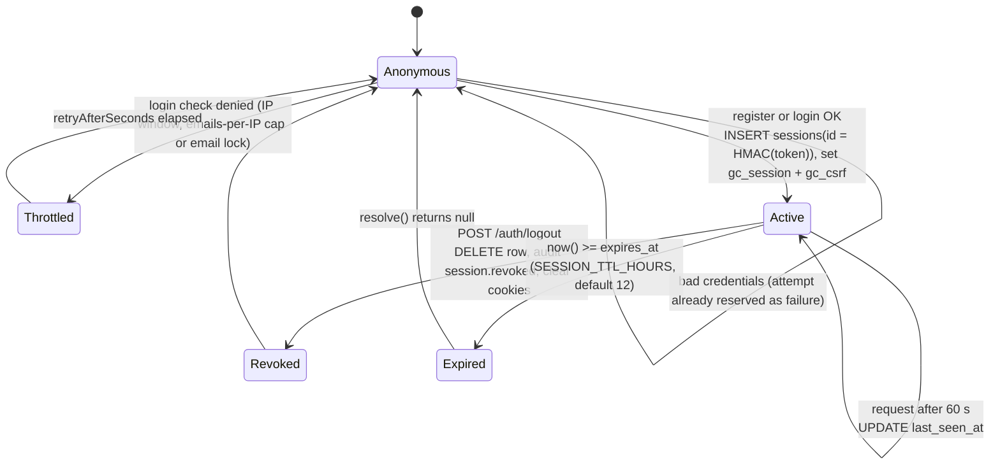
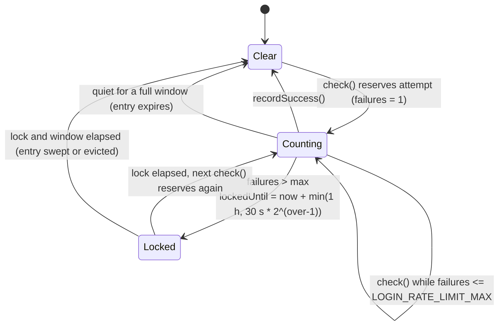
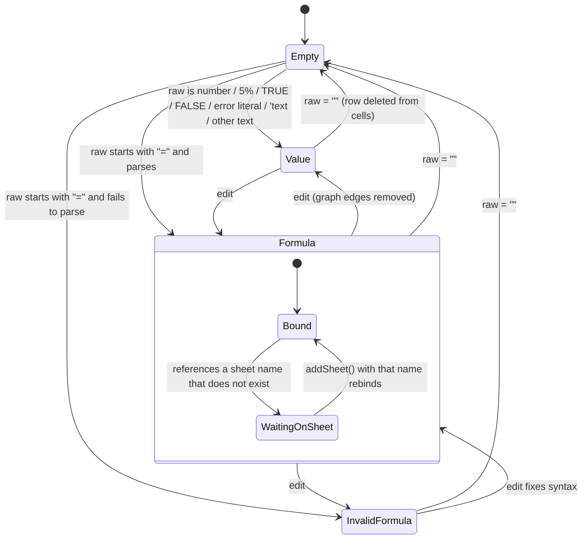
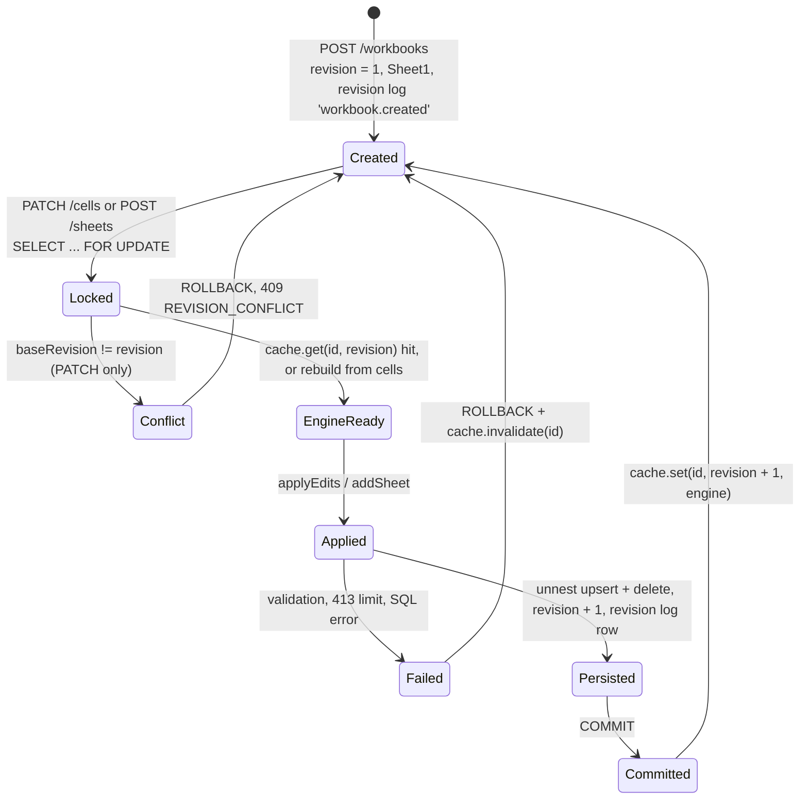
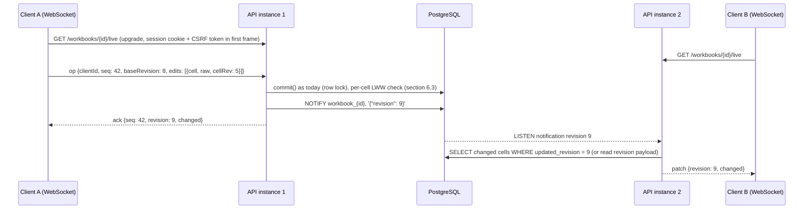

# System design

This document explains how gridcalc computes, stores and serializes spreadsheet state: the state
machines, the main interaction sequences, the formula and recalculation algorithms with their
complexity, the concurrency strategy, and sketches of the planned algorithms. Code paths are
given so every statement can be checked against the source.

Status legend: **[implemented]** exists in the repository and is covered by tests;
**[planned GC-xxx]** is a design for a backlog ticket and does not exist yet.

Contents:

1. [State machines](#1-state-machines)
2. [Sequences](#2-sequences)
3. [Formula pipeline algorithms](#3-formula-pipeline-algorithms)
4. [Recalculation algorithms](#4-recalculation-algorithms)
5. [Concurrency and consistency](#5-concurrency-and-consistency)
6. [Planned algorithms](#6-planned-algorithms)

---

## 1. State machines

### 1.1 Session lifecycle [implemented]

Code: `apps/api/src/modules/auth/auth.service.ts`, `auth.plugin.ts`, `login-throttle.ts`.



- Expiry is absolute (no sliding extension). `last_seen_at` is informational.
- Expired rows are not deleted by the application today; `sessions_expires_idx` exists so a sweep
  can be added cheaply (session management is GC-019).
- A session is bound to one organization (`sessions.organization_id`). Switching organizations is
  planned with GC-014.

Per-email throttle sub-state (inside `LoginThrottle`):



### 1.2 Cell content kinds [implemented]

Code: `packages/shared/src/formula/cell-input.ts` (`parseCellInput`), `engine/recalc-engine.ts`
(`store`, `initialValue`).



| Kind              | Stored value                                                    | Graph            | Notes                                                                                 |
| ----------------- | --------------------------------------------------------------- | ---------------- | ------------------------------------------------------------------------------------- |
| `empty`           | no row                                                          | no edges         | Only `""` is empty; a lone `"="` is text                                              |
| `value`           | number, string, boolean or error                                | none             | `'` prefix forces text; numeric text accepts `1e3`, `.5`, `5%` (0.05)                 |
| `formula`         | result of evaluation                                            | precedents bound | Value is `null` between `store()` and evaluation, never observable outside the engine |
| `invalid-formula` | `#ERROR!` with parser message, position offset by 1 for the `=` | none             | Reported as `isFormula: true`                                                         |

### 1.3 Workbook revision and commit [implemented]

Code: `apps/api/src/modules/workbooks/workbook.service.ts` (`commit`), `engine-cache.ts`.



The diagram's `Created` state means "committed at revision r and idle". Each successful commit
increases `workbooks.revision` by exactly one and appends exactly one `workbook_revisions` row with
the same number, so `workbook_revisions` is gap-free from 1 to the current revision.

---

## 2. Sequences

### 2.1 Edit commit (happy path) [implemented]

See the full HTTP lifecycle in [architecture/overview.md section 5](../architecture/overview.md#5-request-lifecycle-patch-apiv1workbooksworkbookidcells).
The engine-level steps inside `applyEdits`:

```mermaid
sequenceDiagram
    participant S as WorkbookService
    participant E as RecalcEngine
    participant G as DependencyGraph
    participant V as evaluator

    S->>E: applyEdits(edits)
    E->>E: validate bounds and sheet ids; keep last edit per cell
    loop each edited cell
        E->>G: removeFormula(key)
        E->>E: parseCellInput(raw) -> content, initial value
        E->>G: setPrecedents(key, cells, ranges) (formulas only)
    end
    E->>G: collectDirty(edited)  (BFS over dependents)
    E->>E: dirty += edited formulas; snapshot old values of dirty
    E->>G: planRecalc(dirty)  (iterative Tarjan)
    G-->>E: order, cyclic
    loop key in order
        E->>V: evaluateToScalar(ast, ctx) or #CYCLE!
    end
    E-->>S: changed = edited + dirty cells whose value changed (frozen)
```

### 2.2 Stale revision, 409 [implemented]

```mermaid
sequenceDiagram
    participant A as Client A
    participant B as Client B
    participant S as API
    participant P as PostgreSQL

    A->>S: PATCH baseRevision=7
    B->>S: PATCH baseRevision=7
    S->>P: A: BEGIN; SELECT ... FOR UPDATE (gets lock)
    S->>P: B: BEGIN; SELECT ... FOR UPDATE (blocks)
    S->>P: A: persist, revision = 8, COMMIT
    S-->>A: 200 {revision: 8}
    P-->>S: B: lock granted, row shows revision 8
    S->>P: B: ROLLBACK
    S-->>B: 409 REVISION_CONFLICT {currentRevision: 8}
    B->>S: GET .../cells?range=... (reload active sheet)
    Note over B: WorkbookPage asks the user to re-apply the edit
```

Covered by `apps/api/test/workbooks.int.test.ts` ("serializes concurrent writers: exactly one wins
per revision").

### 2.3 Add sheet with deferred binding [implemented]

A formula may reference a sheet that does not exist yet, for example `=Data!A1*2` typed before the
`Data` sheet is created. It evaluates to `#REF!` and waits.

```mermaid
sequenceDiagram
    participant C as Client
    participant S as WorkbookService.addSheet
    participant P as PostgreSQL
    participant E as RecalcEngine

    C->>S: POST /workbooks/{id}/sheets {name: "Data"}
    S->>P: BEGIN; SELECT ... FOR UPDATE (no baseRevision check)
    S->>S: case-insensitive name clash? -> 409 CONFLICT
    S->>P: INSERT sheets (position = max + 1)
    S->>E: addSheet({id, name})
    E->>E: registerSheet; waiting = waitingOnSheet["data"]
    E->>E: bind(each waiting key): precedents now resolve to the new sheet id
    E->>E: dirty = waiting + collectDirty(waiting); evaluate
    E-->>S: changed (formulas that went from #REF! to values, and their dependents)
    S->>P: audit sheet.created; persist changed; revision + 1; log 'sheet.created'; COMMIT
    S-->>C: 201 {revision, changed, evaluated, cycles, sheet}
```

### 2.4 Planned collaboration flow [planned GC-088, GC-089, GC-093]



---

## 3. Formula pipeline algorithms

### 3.1 Tokenizer [implemented]

Code: `packages/shared/src/formula/tokenizer.ts`. Input is the formula text after `=`, at most
`MAX_FORMULA_LENGTH = 8192` characters.

Dispatch on the first character of each token:

| First char              | Token                     | Rule                                                                                  |
| ----------------------- | ------------------------- | ------------------------------------------------------------------------------------- |
| whitespace              | (skipped)                 | `/\s/`                                                                                |
| `"`                     | `string`                  | Ends at the next unpaired `"`; `""` inside is an escaped quote. Unterminated -> error |
| `'`                     | `sheet`                   | Quoted sheet name, `''` escapes `'`, must be followed by `!`, must be non-empty       |
| `#`                     | `error`                   | Longest match among the 9 error codes, case-insensitive (`#DIV/0!` before `#N/A`)     |
| `0-9` or `.`            | `number`                  | `^(?:\d+\.?\d*                                                                        | \.\d+)(?:[eE][+-]?\d+)?` |
| letter, `_`, `$`, `\`   | word                      | Read `[A-Za-z0-9_.$\\]*`, then classify (below)                                       |
| `(` `)` `,`             | `lparen` `rparen` `comma` |                                                                                       |
| `<= >= <>`              | `operator`                | Two-character operators tried first                                                   |
| `+ - * / ^ & = < > % :` | `operator`                |                                                                                       |

Word classification, in order: followed by `!` -> `sheet` (unquoted prefix); followed by `(` and
no `$` -> `function` (upper-cased); `TRUE`/`FALSE` -> `boolean`; valid in-bounds A1 reference
(`/^(\$?)([A-Za-z]{1,3})(\$?)([0-9]{1,7})$/`, row <= 1,048,576, column <= XFD) -> `cell`;
contains `$` -> syntax error; otherwise `name` (evaluates to `#NAME?` until named ranges, GC-028).

Complexity: each character is examined a constant number of times by the main loop and the
per-token readers, so the scan is O(n). One implementation detail deviates: `readNumber` runs the
regular expression on `input.slice(start)`, which copies the rest of the input for every numeric
token. The worst case is O(n * m) for m numeric tokens, bounded by the 8,192-character limit
(about 17 million character copies for a pathological 8,192-character `1+1+1+...` formula with 4,096 numbers). Switching to a sticky
regular expression (`/.../y` with `lastIndex = start`) restores strict O(n) without behaviour
change.

### 3.2 Pratt parser and binding powers [implemented]

Code: `packages/shared/src/formula/parser.ts`, AST in `ast.ts`.

| Operator                   | Kind                       | Left binding power | Right operand parsed with | Associativity |
| -------------------------- | -------------------------- | -----------------: | ------------------------: | ------------- |
| `=` `<>` `<` `>` `<=` `>=` | infix                      |                 10 |                        11 | left          |
| `&`                        | infix                      |                 20 |                        21 | left          |
| `+` `-`                    | infix                      |                 30 |                        31 | left          |
| `*` `/`                    | infix                      |                 40 |                        41 | left          |
| `^`                        | infix                      |                 50 |                        51 | **left**      |
| `%`                        | postfix                    |                 60 |                         - | -             |
| `-` `+`                    | prefix                     |                  - |                        70 | -             |
| `:`                        | infix (cell `:` cell only) |                 80 |                         - | -             |

The loop in `parseExpression(minPower)` parses a prefix expression, then repeatedly consumes an
operator whose binding power is at least `minPower`, parsing the right side with `power + 1`. That
`+1` is what makes every binary operator left-associative.

Consequences users will notice:

| Formula      | Parse                                              | Result                                 |
| ------------ | -------------------------------------------------- | -------------------------------------- |
| `=-2^2`      | `(-2)^2` (prefix 70 binds tighter than `^` 50)     | `4`                                    |
| `=2^3^2`     | `(2^3)^2`                                          | `64`                                   |
| `="a"&1+2`   | `"a"&(1+2)`                                        | `"a3"`                                 |
| `=1<2=TRUE`  | `(1<2)=TRUE`                                       | `TRUE`                                 |
| `=50%*2`     | `(50%)*2`                                          | `1`                                    |
| `=-A1:A3`    | `-(A1:A3)`                                         | `#VALUE!` (multi-cell range as scalar) |
| `=IF(A1,,2)` | third argument present, second is a `missing` node | missing evaluates to empty             |

Range rules: the left side of `:` must be a cell node; a sheet prefix is allowed only before the
start (`Data!A1:B5`, not `A1:Data!B5`); the range is normalized (`B5:A1` covers `A1:B5`).

Limits: `MAX_DEPTH = 64` nested `parseExpression` calls (parentheses, prefix operators, function
arguments and right operands each add one; a flat `1+2+3+...` chain does not grow depth because the
loop is iterative), `MAX_ARGS = 255` per call.

Complexity: every token is consumed exactly once and each `parseExpression` frame does O(1) work
per consumed token, so parsing is O(t) time for t tokens and O(min(t, 64)) stack. The AST has at
most t nodes plus `missing` nodes for empty arguments.

The printer (`printer.ts`) is the inverse used for normalization and, later, for reference
rewriting. It parenthesizes every nested binary or unary operand, so the printed text never depends on
precedence to be read back the same way.

### 3.3 Evaluator and coercion [implemented]

Code: `packages/shared/src/formula/evaluator.ts`, `coercion.ts`, `values.ts`.

The evaluator is a recursive tree walk with no access to workbook state except through
`EvaluationContext { currentSheetId, resolveSheet(name), getCellValue(sheetId, row, col) }`.

Value model: `Scalar = number | string | boolean | null | ErrorValue`; ranges evaluate to
`RangeValue { rows: Scalar[][] }`. A cell stores only a scalar; `toScalar` collapses a 1x1 range to
its cell and any larger range to `#VALUE!`.

Coercion table:

| From \ To                        | Number (`toNumber`) | Text (`toText`)                         | Boolean (`toBoolean`)                           |
| -------------------------------- | ------------------- | --------------------------------------- | ----------------------------------------------- |
| empty                            | `0`                 | `""`                                    | `FALSE`                                         |
| number                           | itself              | `formatGeneral` (15 significant digits) | `n != 0`                                        |
| `""`                             | `0`                 | `""`                                    | `#VALUE!`                                       |
| numeric text (`" 1e3 "`, `"5%"`) | parsed              | itself                                  | `#VALUE!`                                       |
| other text                       | `#VALUE!`           | itself                                  | `TRUE`/`FALSE` case-insensitive, else `#VALUE!` |
| boolean                          | `1` / `0`           | `"TRUE"` / `"FALSE"`                    | itself                                          |
| error                            | the error           | the error                               | the error                                       |

Operators:

- Errors propagate left operand first, then right.
- `&` concatenates `toText` of both sides.
- Comparisons use `compareScalars`: numbers < text < booleans; text compares case-insensitively;
  numbers compare after rounding both to 15 significant digits; empty acts as `0`, `""` or `FALSE`
  depending on the other side.
- `+ * /` use IEEE doubles; `/` by zero gives `#DIV/0!`; a non-finite result gives `#NUM!`.
- `-` rounds its result to 15 significant digits, so `=0.3-0.1-0.2` is exactly `0`. Addition is
  not rounded; `=0.1+0.2` stores `0.30000000000000004` and displays `0.3` through `formatGeneral`,
  and compares equal to `0.3`.
- `^` goes through `powerOf` in `functions/math.ts`.

Function calls: unknown name -> `#NAME?`; wrong arity -> `#VALUE!`. **Lazy** functions (`IF`,
`IFERROR`, `CHOOSE`) receive AST nodes and evaluate only the branches they need. **Eager** functions
receive evaluated arguments; a bare cell reference argument is wrapped as a 1x1 range so that
`SUM(A1)` ignores text in `A1` (range semantics) while `SUM("x")` is `#VALUE!` (literal semantics).

Ranges: `evaluateRange` materializes the normalized rectangle row-major by calling `getCellValue`
for every position, including empty ones. Areas above `MAX_RANGE_CELLS = 2,000,000` return `#NUM!`
without reading.

Complexity: O(N + sum of range areas) per evaluation, where N is the AST node count; recursion depth
is bounded by the parser's depth limit. Approximate `MATCH`/`VLOOKUP`/`HLOOKUP` use binary search,
O(log k) comparisons on k keys after the O(k) materialization of the range.

### 3.4 Precedent extraction [implemented]

Code: `packages/shared/src/formula/dependencies.ts` (`collectPrecedents`).

A single AST walk collects:

- `cells`: every `cell` node, resolved to `{sheetId, row, col}`;
- `ranges`: every `range` node, normalized to `{sheetId, top, left, bottom, right}`;
- `unresolvedSheets`: names that `resolveSheet` could not map.

All arguments of every call are visited, including both branches of `IF` and every `CHOOSE`
option. The static set is therefore a superset of what any evaluation can read. This is the
property incremental recalculation depends on (section 4.6). The trade-off is that an untaken
branch still creates an edge: `A1: =IF(TRUE, 1, A1)` is a self-loop and evaluates to `#CYCLE!`.

Complexity: O(N) in AST nodes; duplicates are removed when the graph stores cell edges.

---

## 4. Recalculation algorithms

### 4.1 Data structures [implemented]

Code: `packages/shared/src/graph/dependency-graph.ts`, `range-index.ts`, `cell-key.ts`.

- `CellKey` = `"${sheetId}|${row}|${col}"`, parsed from the right so sheet ids may contain `|`.
- `cellPrecedents: Map<CellKey, CellKey[]>`: deduplicated single-cell precedents per formula.
- `cellDependents: Map<CellKey, Set<CellKey>>`: reverse edges for single-cell references.
- `RangeIndex`: reverse index for range references (section 4.2).

An edge P -> F means formula F reads P. Only formulas have outgoing precedent lists, but any
cell (value, empty or formula) can have dependents.

### 4.2 Range index: column buckets and the wide list [implemented]

Storing a range `A1:A10000` as 10,000 cell edges would make `SUM` columns quadratic in memory.
Instead each range is stored once per covered **column**:

```
per sheet:
  byColumn: Map<col, Set<Entry{formula, range}>>
  wide:     Set<Entry>         // ranges spanning more than WIDE_RANGE_COLUMNS = 64 columns
entriesByFormula: Map<CellKey, Entry[]>   // for O(width) removal
```

| Operation                | Cost                                                              |
| ------------------------ | ----------------------------------------------------------------- |
| `add(formula, ranges)`   | O(sum of min(width, 1 if wide)) set inserts; at most 64 per range |
| `remove(formula)`        | Same as add                                                       |
| `formulasCovering(cell)` | O(\|byColumn[cell.col]\| + \|wide\|) containment tests            |
| Memory                   | At most 64 entries per range, independent of row count            |

A lookup scans only ranges that intersect the cell's column, then tests the row interval. The
known weak case is many tall ranges stacked in one column (for example 10,000 running totals
`=SUM($A$1:A1)` ... `=SUM($A$1:A10000)`): the bucket for column A holds 10,000 entries and every
lookup in column A scans them all. GC-047 replaces the bucket scan with a 2D interval tree, giving
O(log r + k) for k matches.

### 4.3 Dirty set: BFS over dependents [implemented]

```
collectDirty(changed):
  dirty = {}
  queue = [...changed]
  for i = 0; i < queue.length; i++:
    for d in directDependents(queue[i]):      // cellDependents ∪ RangeIndex.formulasCovering
      if d not in dirty: dirty.add(d); queue.push(d)
  return dirty
```

The queue is an array with a read index (no `shift`, so O(1) dequeue). Each dirty formula is
enqueued once. Cost: O(V_d + E_d + L_d) where V_d is the dirty set size, E_d the cell edges
leaving it, and L_d the range-index scan cost of the `V_d + |changed|` lookups. The edited cells are
seeds, not members; `applyEdits` adds edited formula cells to the dirty set explicitly so they are
evaluated even when nothing upstream changed.

### 4.4 Evaluation order: iterative Tarjan SCC [implemented]

`planRecalc(dirty)` runs Tarjan's strongly connected components algorithm on the subgraph induced
by `dirty`, with successors `directDependents(node) ∩ dirty`. Recursion is replaced by an explicit
frame stack `{node, next[], i}` so a 100,000-long chain cannot overflow the call stack
(`packages/shared/test/dependency-graph.test.ts`, "handles a 100k-long chain without recursion
limits").

```
for root in dirty not yet indexed:
  push frame(open(root))
  while frames:
    f = top
    if f.i < f.next.length:
      w = f.next[f.i++]
      if w unindexed: push frame(open(w))
      elif w onStack: low[f] = min(low[f], index[w])
    else:
      pop f; if parent: low[parent] = min(low[parent], low[f])
      if low[f] == index[f]: pop stack down to f -> one component
order = components in reverse emission order
```

Why reversed: Tarjan emits a component only after every component reachable from it. Edges point
from precedent to dependent, so reachable means downstream; the emission order is
downstream-first, and its reverse is a topological order of the condensation (precedents before
dependents).

Complexity: O(V_d + E_d) for the traversal plus the range-index scans in `successors`. Successor
lists are recomputed in `planRecalc` rather than reused from the BFS; caching them is a cheap
constant-factor improvement for GC-102 if needed.

### 4.5 Cycle handling [implemented]

A component is cyclic when it has more than one member, or one member with a self-loop (detected
when `open()` sees the node in its own successor list). Every cyclic member is assigned
`#CYCLE!` (message "Circular reference") instead of being evaluated. Formulas downstream of a cycle
evaluate normally and see `#CYCLE!` as an input, so the error propagates unless caught
(`=IFERROR(A1, 0)`).

Correctness of detecting cycles only inside the dirty subgraph: if any member of a strongly
connected component is dirty, every member is a transitive dependent of it, so the whole component
is dirty. SCCs of the dirty subgraph are therefore exactly the global SCCs that intersect it.

Recovery: editing any member breaks or re-forms the cycle; the edited cell and its dependents are
dirty, so all former members are re-evaluated with real values. Intentional iterative calculation
is planned (GC-048).

### 4.6 Incremental versus full equivalence [implemented]

Claim: after any sequence of `applyEdits` batches, every cell value equals the value
`RecalcEngine.create` computes from scratch on the same raw contents.

Argument: a formula's value is a function of its AST and the values it reads. Static precedents
are a superset of reads (section 3.4), and sheet resolution only changes through `addSheet`, which
rebinds and dirties waiting formulas. A formula outside the dirty set has no path from any edited
cell, so by induction over the topological order all its inputs are unchanged and its stored value
is still correct. Formulas inside the dirty set are evaluated in topological order, so each sees
final values of its precedents. Cycle members get `#CYCLE!` in both modes because the SCC
decomposition is the same.

Test: `packages/shared/test/recalc-engine.test.ts`, "incremental == full recalculation
(randomized)". 25 seeds; each seed applies 60 batches of 1 to 3 random edits over a 6x4 grid on two
sheets (values, blanks, `+`, `SUM` ranges, `IF`, cross-sheet `Data!`, division, `IFERROR` with
concatenation), and after every batch compares the incremental engine to a freshly built one, cell
by cell.

### 4.7 End-to-end engine costs

| Operation                            | Cost                                                                                                                                       |
| ------------------------------------ | ------------------------------------------------------------------------------------------------------------------------------------------ |
| `RecalcEngine.create(sheets, cells)` | O(C + sum of AST sizes + V + E + L) for C cells, V formulas, E cell edges, L range-index work; evaluation adds the sum of range areas read |
| `applyEdits(k edits)`                | O(k * (parse + bind)) + O(V_d + E_d + L_d) + evaluation of V_d formulas                                                                    |
| `addSheet`                           | O(waiting formulas + their dirty closure)                                                                                                  |
| Memory                               | O(C + E + 64 * ranges) plus the AST per formula                                                                                            |

---

## 5. Concurrency and consistency

### 5.1 Single writer per workbook [implemented]

Every write goes through `WorkbookService.commit()`, which opens a transaction and runs
`SELECT ... FROM workbooks WHERE id = $1 AND organization_id = $2 AND deleted_at IS NULL FOR UPDATE`.
The row lock serializes writers for that workbook across all API processes; writers on different
workbooks never contend. `RecalcEngine` is single-writer by design (ADR-0006); holding the lock
while mutating the engine is what makes sharing a cached engine safe.

### 5.2 Revision as optimistic concurrency token [implemented]

`PATCH /cells` carries `baseRevision`. Under the lock, `workbook.revision !== baseRevision`
returns `409 REVISION_CONFLICT` with `details.currentRevision`. A successful commit sets
`revision = revision + 1` and writes `cells.updated_revision` for every persisted cell. Adding a
sheet passes `null` and skips the check, because it cannot overwrite user edits.

### 5.3 Engine cache validity [implemented]

`EngineCache` (default 16 entries) maps workbook id -> `{revision, engine}`, with least recently
used eviction through `Map` insertion order.

- `get(id, revision)` returns the engine only if its revision equals the locked row's revision;
  a mismatch deletes the entry and the engine is rebuilt from `cells`.
- `set(id, revision + 1, engine)` runs only after `COMMIT` succeeded.
- `ENGINE_CACHE_SIZE=0` disables caching (every write rebuilds).

### 5.4 Failure invalidation [implemented]

`applyEdits` mutates the engine before the database commit. If anything fails afterwards
(413 cell limit, unknown sheet id, SQL error, connection loss), the transaction rolls back and
`cache.invalidate(id)` discards the engine, whose state now matches no committed revision. The next
write rebuilds from PostgreSQL. A `409` happens before the engine is obtained and does not evict.

Residual risk: if the process crashes between `COMMIT` and `cache.set`, nothing is lost because
the cache is in memory; the next process rebuilds.

### 5.5 Reads [implemented]

`GET .../cells` reads the workbook row and then the cell window with separate statements under
READ COMMITTED, without the lock. A commit landing between the two statements makes the cells one
revision newer than the returned `revision`. This is safe in the direction that matters: the
client's next PATCH carries the older revision, gets 409 and reloads. A client can never be told a
revision newer than the cells it holds.

### 5.6 Multiple API instances

| Concern                       | Behaviour today                                                                | Plan                                                                                        |
| ----------------------------- | ------------------------------------------------------------------------------ | ------------------------------------------------------------------------------------------- |
| Write correctness             | Correct: row lock + revision check + revision-keyed cache                      | -                                                                                           |
| Cache efficiency              | Each instance keeps its own LRU; alternating instances rebuild on every switch | Route by workbook id at the proxy (sticky) as operational practice; engine snapshots GC-038 |
| Login/registration throttling | In-memory per instance; limits multiply by instance count                      | Postgres counters GC-008 (required before running more than one instance)                   |
| Change fan-out                | None (clients learn about other writers via 409)                               | LISTEN/NOTIFY GC-093                                                                        |

---

## 6. Planned algorithms

### 6.1 Reference rewriting on insert/delete rows and columns [planned GC-060, GC-061]

Operation `insertRows(sheet S, at r, count n)`; deletes use `deleteRows(S, r, n)` covering rows
`[r, r+n)`. Columns are symmetric (GC-061).

For every formula in the workbook whose AST references sheet S (found through the reverse indexes,
not a full scan, plus formulas on S itself when relative references move with their host):

```
rewriteRef(ref on S):                          // absolute and relative refs move alike
  insert: if ref.row >= r: ref.row += n
  delete: if ref.row in [r, r+n): -> #REF!
          elif ref.row >= r+n: ref.row -= n
rewriteRange(top..bottom on S):
  insert: if top >= r: top += n; if bottom >= r: bottom += n   // insert inside a range grows it
  delete: remove [r, r+n) from [top, bottom]; empty -> #REF!; else shrink and shift
```

The rewritten AST is printed with `printFormula` into a new `raw`; the host cell itself moves when
it lies on S below r. Persistence is a set-based `UPDATE cells SET row_idx = row_idx + n WHERE
sheet_id = S AND row_idx >= r` (in descending order, or via a temporary offset, to avoid primary-key
collisions) plus rewritten `raw` values, all inside `commit()`. Cost: O(F_S * AST) for F_S formulas
referencing S, plus O(cells moved) in SQL. Named ranges (GC-028), conditional formats, validations
and charts store ranges and go through the same `rewriteRange`.

### 6.2 Copy/paste adjustment [planned GC-071]

Pasting a formula from (r0, c0) to (r1, c1) shifts every relative component by
(dr, dc) = (r1 - r0, c1 - c0); `$`-anchored components (`rowAbsolute`, `colAbsolute` in `CellRef`)
stay. A component shifted outside the sheet becomes `#REF!`. Sheet prefixes are kept. Pasting an
m x k block is O(m * k * AST) and becomes one `PATCH`-equivalent batch, so recalculation and
conflict handling are reused unchanged.

### 6.3 Collaboration: cell-level last-writer-wins with revision vectors [planned GC-089, ADR-0017]

Each cell already carries `updated_revision`. A client op records, for each edited cell, the
`updated_revision` it last saw (`cellRev`). The server, under the workbook lock:

```
for edit in op.edits:
  current = cells[edit.cell].updated_revision (0 if absent)
  if current <= edit.cellRev:  apply           // nobody touched this cell since the client saw it
  else:                        apply (LWW) and report the overwritten value to the client
                               OR reject per cell if the op requested strict mode
```

Unlike today's whole-workbook `baseRevision`, two users editing different cells never conflict.
The "vector" is the set of per-cell revisions the client observed; it is O(edited cells) per op.
Structural ops (insert/delete rows) are transformed against concurrent cell ops by applying
`rewriteRef` to pending client ops (an operational-transform step limited to coordinates).
Fan-out uses LISTEN/NOTIFY with only the new revision number in the payload (GC-093), and
reconnecting clients replay from `workbook_revisions` (GC-092).

### 6.4 Spill ranges [planned GC-034]

A dynamic-array formula returns a `RangeValue` of h x w. The engine records a spill rectangle
anchored at the formula cell. If any other cell in the rectangle is non-empty, the anchor shows
`#SPILL!` (a new error code) and nothing spills. Spilled cells are read-only projections: they get
values but no `raw`. Dependency edges: formulas reading any spilled cell depend on the anchor (the
spill rectangle is registered in the range index as an output range), and the anchor depends on
every cell in its rectangle so a later edit there re-triggers the `#SPILL!` check. Resizing a spill
dirties both the old and new rectangles.
