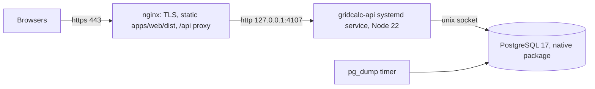

# Deployment (bare metal or VM)

gridcalc deploys as one Node.js process plus static files and a natively installed PostgreSQL. No containers are involved.



## Single-instance constraint

Run **exactly one** API process until GC-008 (shared throttle counters in Postgres) and GC-093 (cross-instance
fan-out) are done. The engine cache is already safe across instances, but login throttling is per process
(see the [threat model](../security/threat-model.md)). Scale vertically: more CPU helps recalculation, more RAM allows a larger `ENGINE_CACHE_SIZE`.

## Host preparation (Debian/Ubuntu example)

```bash
sudo apt-get install -y postgresql nginx
curl -fsSL https://deb.nodesource.com/setup_22.x | sudo -E bash - && sudo apt-get install -y nodejs
sudo useradd --system --home /opt/gridcalc --shell /usr/sbin/nologin gridcalc
sudo -u postgres createuser gridcalc
sudo -u postgres createdb --owner gridcalc gridcalc
```

`/etc/gridcalc/gridcalc.env` (mode 0600, owner root):

```bash
NODE_ENV=production
API_HOST=127.0.0.1
API_PORT=4107
APP_ORIGIN=https://sheets.example.com
DATABASE_URL=postgres:///gridcalc?host=/var/run/postgresql
SESSION_SECRET=<64 hex chars from: openssl rand -hex 32>
COOKIE_SECURE=true
TRUST_PROXY=1
LOG_LEVEL=info
```

`TRUST_PROXY=1` trusts exactly one hop: the local nginx. If a separate load balancer sits in front, list its
addresses instead (`TRUST_PROXY=10.0.0.10,10.0.0.11`). Never trust all hops.

## systemd unit

`/etc/systemd/system/gridcalc-api.service`:

```ini
[Unit]
Description=gridcalc API
After=network-online.target postgresql.service
Wants=network-online.target

[Service]
Type=simple
User=gridcalc
WorkingDirectory=/opt/gridcalc/current/apps/api
EnvironmentFile=/etc/gridcalc/gridcalc.env
ExecStartPre=/usr/bin/node dist/db/cli.js migrate
ExecStart=/usr/bin/node dist/index.js
Restart=on-failure
RestartSec=3
NoNewPrivileges=true
ProtectSystem=strict
ProtectHome=true
PrivateTmp=true
ReadOnlyPaths=/opt/gridcalc
MemoryMax=2G

[Install]
WantedBy=multi-user.target
```

## nginx

```nginx
server {
  listen 443 ssl http2;
  server_name sheets.example.com;
  ssl_certificate     /etc/ssl/gridcalc/fullchain.pem;
  ssl_certificate_key /etc/ssl/gridcalc/privkey.pem;
  add_header Strict-Transport-Security "max-age=31536000; includeSubDomains" always;

  root /opt/gridcalc/current/apps/web/dist;
  location / { try_files $uri /index.html; }
  location /assets/ { expires 1y; add_header Cache-Control "public, immutable"; }

  location /api/ {
    proxy_pass http://127.0.0.1:4107;
    proxy_set_header Host $host;
    proxy_set_header X-Forwarded-For $remote_addr;   # overwrite, never append client-supplied values
    proxy_set_header X-Forwarded-Proto https;
    client_max_body_size 4m;
    proxy_read_timeout 60s;
  }
}
server { listen 80; server_name sheets.example.com; return 301 https://$host$request_uri; }
```

TLS certificates come from your own CA or an ACME client that runs on the host. The application makes no outbound calls.

## Release procedure

1. CI is green on the commit (`.github/workflows/ci.yml`).
2. On a build host: `npm ci && npm run build`, then package `apps/api/dist`, `apps/api/migrations`, `apps/api/package.json`, `apps/web/dist`, the root `package.json` and `package-lock.json` as `gridcalc-<version>.tar.gz`.
3. Take a backup: `pg_dump --format=custom ... > pre-<version>.dump`.
4. Unpack to `/opt/gridcalc/releases/<version>`, run `npm ci --omit=dev --workspace @gridcalc/api` there, and point the symlink `/opt/gridcalc/current` at it.
5. `sudo systemctl restart gridcalc-api` (migrations run in `ExecStartPre` under the advisory lock).
6. Gate: `curl -fsS https://sheets.example.com/api/v1/health/ready` and a smoke login.
7. Reload nginx if its configuration changed.

## Rollback

- **Code only (no new migrations in the release):** point `current` back at the previous release and restart.
- **Release added migrations:** migrations are forward-only and are written to be backward compatible for one
  release (additive columns and tables, no destructive change in the same release). Roll the code back as above.
  The previous version ignores new tables and columns.
- **Data damage:** stop the API, restore `pre-<version>.dump` into a new database, switch `DATABASE_URL`, start the previous release.

## Capacity notes

- Recalculation runs on the API event loop. Typical edits touch tens to thousands of formulas (milliseconds),
  and the hard limits (1,000 edits per request, 200k cells per workbook) bound the worst case. Worker-thread recalc is GC-037.
- PostgreSQL: the default settings work. Set `shared_buffers` to 25% of RAM on dedicated hosts. The hot tables are `cells` (primary key and `workbook_id` index) and `workbooks`.
