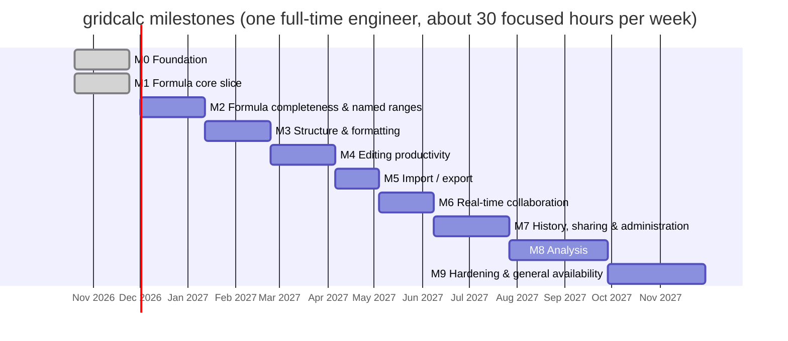

# Roadmap

Milestones are sequential gates. A milestone exits only when its criteria pass in CI. Hours come from [backlog.md](backlog.md).

| Milestone | Theme                               | Tickets | Hours | Status  |
| --------- | ----------------------------------- | ------: | ----: | ------- |
| M0        | Foundation                          |      12 |    61 | Done    |
| M1        | Formula core slice                  |      13 |   117 | Done    |
| M2        | Formula completeness & named ranges |      10 |   192 | Pending |
| M3        | Structure & formatting              |      10 |   192 | Pending |
| M4        | Editing productivity                |       8 |   174 | Pending |
| M5        | Import / export                     |       5 |   122 | Pending |
| M6        | Real-time collaboration             |       7 |   164 | Pending |
| M7        | History, sharing & administration   |      13 |   204 | Pending |
| M8        | Analysis: pivots & charts           |       9 |   272 | Pending |
| M9        | Hardening & general availability    |      17 |   266 | Pending |

## M0 Foundation

**Goal.** Runnable, secure skeleton: tooling, config, migrations, auth, RBAC, audit, CI.

**Exit criteria.** `./run.sh setup` works on a fresh clone; CI green on native Postgres; auth flows covered by integration tests.

Tickets:

- GC-001 Monorepo tooling: npm workspaces, strict TS, ESLint, Prettier (6 h, done)
- GC-002 Zod-validated config loader and structured logging with redaction (4 h, done)
- GC-003 Fastify app shell: envelope, central errors, request ids, security headers (6 h, done)
- GC-004 Forward-only SQL migration runner (checksums, advisory lock, per-file txn) (6 h, done)
- GC-005 Liveness and readiness endpoints (2 h, done)
- GC-006 run.sh launcher (setup, migrate, seed, reset, test, dev) (5 h, done)
- GC-007 CI pipeline on native runner PostgreSQL (4 h, done)
- GC-010 Organization registration with owner account (non-enumerating errors) (6 h, done)
- GC-011 Session auth: scrypt, HttpOnly cookie, CSRF double-submit, Origin check (10 h, done)
- GC-012 Login throttling: per-IP window + per-email progressive backoff; TRUST_PROXY (5 h, done)
- GC-013 RBAC skeleton: roles to permissions, route guards (4 h, done)
- GC-015 Audit log write path (3 h, done)

## M1 Formula core slice

**Goal.** The hardest core works end to end: formula language, dependency graph, incremental recalculation with cycle detection, persistence with optimistic revisions, virtualized grid.

**Exit criteria.** 43 functions tested; randomized incremental-equals-full property test passes 25 seeds; concurrent writers serialize (one wins, others 409); grid renders a 100k-row sheet with under 200 DOM cells.

Tickets:

- GC-020 Formula tokenizer (refs, sheets, strings, errors, operators) (8 h, done)
- GC-021 Pratt parser to immutable AST, depth/arity limits, printer (12 h, done)
- GC-022 Evaluator: operators, coercion rules, error propagation, ranges (12 h, done)
- GC-023 Function library v1: 43 math/statistical/logical/text/lookup functions (16 h, done)
- GC-030 Dependency graph with column-bucketed range index (10 h, done)
- GC-031 Incremental recalc: dirty closure, iterative Tarjan order, cycle detection (12 h, done)
- GC-032 Randomized incremental-vs-full recalculation equivalence tests (4 h, done)
- GC-040 Workbook, sheet, cell and revision schema plus repositories (6 h, done)
- GC-041 Cell batch PATCH: row lock, optimistic revisions, engine LRU cache (10 h, done)
- GC-042 Function catalog and formula parse endpoints (2 h, done)
- GC-050 Web shell: login, register, layout, navigation with Planned badges (8 h, done)
- GC-051 Virtualized grid with formula bar, sheet tabs and keyboard navigation (14 h, done)
- GC-052 Seed script with demo organization and budget workbook (3 h, done)

## M2 Formula completeness & named ranges

**Goal.** Formula completeness: date/time, XLOOKUP and *IFS, text and statistics v2, named ranges, whole-row/column refs, volatile functions, autocomplete.

**Exit criteria.** 80+ functions with a compatibility test corpus; named ranges participate in the dependency graph; volatile cells recalculate on open and on schedule; formula bar autocomplete.

Tickets:

- GC-024 Date & time functions on the serial-date system (DATE, TODAY, EDATE, NETWORKDAYS...) (28 h, pending)
- GC-025 Lookup v2: XLOOKUP, XMATCH, SUMIFS/COUNTIFS/AVERAGEIFS, MAXIFS/MINIFS, SUMPRODUCT (24 h, pending)
- GC-026 Text v2: TEXT, FIND/SEARCH, SUBSTITUTE, REPLACE, TEXTJOIN, VALUE, PROPER (20 h, pending)
- GC-027 Math/stat v2: MEDIAN, STDEV, VAR, RANK, LARGE/SMALL, LOG/EXP, trig, RAND (20 h, pending)
- GC-028 Named ranges: definitions, scoping, parser binding, graph edges, API (24 h, pending)
- GC-029 Whole-row/column references (A:A, 1:1) and 3D references (18 h, pending)
- GC-033 Volatile functions and dynamic references (INDIRECT, OFFSET) scheduling (20 h, pending)
- GC-035 Formula autocomplete, signature help and reference highlighting (16 h, pending)
- GC-043 Workbook rename, soft delete and duplicate (10 h, pending)
- GC-045 Workbook search, sorting, pagination UI and templates gallery (12 h, pending)

## M3 Structure & formatting

**Goal.** Structure and formatting: insert/delete rows and columns with reference rewriting, sheet management, styles, number formats, merges, sizing, freeze panes.

**Exit criteria.** Property test: rewrite-then-evaluate equals evaluate-then-shift for random structural edits; number format engine passes the format-code corpus; styles stored as range runs.

Tickets:

- GC-044 Sheet rename (with formula rewriting), reorder, hide, delete (16 h, pending)
- GC-053 Resizable column widths and row heights with persistence (12 h, pending)
- GC-054 Multi-cell range selection (shift/ctrl, select all) and selection stats (14 h, pending)
- GC-055 Freeze panes (12 h, pending)
- GC-060 Insert/delete rows with reference rewriting (#REF! on deleted refs) (32 h, pending)
- GC-061 Insert/delete columns with reference rewriting (16 h, pending)
- GC-063 Hide/unhide and group rows and columns (12 h, pending)
- GC-064 Cell style model with range-run storage (font, fill, borders, alignment) (28 h, pending)
- GC-065 Number format engine (custom codes, dates, percent, currency) (36 h, pending)
- GC-068 Merge cells (14 h, pending)

## M4 Editing productivity

**Goal.** Editing productivity: undo/redo command stack, copy/paste with relative adjustment, paste special, fill, sort, filter, find and replace, range selection.

**Exit criteria.** Every command has a tested inverse; paste adjusts relative references and preserves absolute ones; sort is stable and multi-key.

Tickets:

- GC-057 Find and replace across sheets (14 h, pending)
- GC-062 Move range with dependent formula rewriting (20 h, pending)
- GC-070 Command model and undo/redo stack with server inverse operations (32 h, pending)
- GC-071 Copy/paste with relative reference adjustment (24 h, pending)
- GC-072 Paste special (values, formats, transpose) and external TSV/HTML clipboard (20 h, pending)
- GC-073 Fill handle and series detection (20 h, pending)
- GC-074 Multi-key stable range sort with formula adjustment (20 h, pending)
- GC-075 Auto-filter with value and condition filters (24 h, pending)

## M5 Import / export

**Goal.** Import/export: streaming CSV in and out, XLSX-lite import/export with an in-house zip/deflate reader, background job queue.

**Exit criteria.** Round-trip of the reference workbook set preserves values and formulas; zip-bomb and oversized-entry tests; imports run as jobs with progress.

Tickets:

- GC-083 CSV import: streaming parser, delimiter and type inference (16 h, pending)
- GC-084 CSV export per sheet (6 h, pending)
- GC-085 XLSX-lite import: in-house zip/deflate reader and SpreadsheetML subset (48 h, pending)
- GC-086 XLSX-lite export: values, formulas, basic styles (36 h, pending)
- GC-087 Background job runner for imports (Postgres SKIP LOCKED queue) (16 h, pending)

## M6 Real-time collaboration

**Goal.** Real-time collaboration: WebSocket gateway, cell-level merge with revision vectors, presence, offline queue, cross-instance fan-out, worker-thread recalc.

**Exit criteria.** Randomized concurrent-replica test converges; two browsers editing one sheet see each other within 200 ms p95 on a LAN; recalc no longer blocks the event loop.

Tickets:

- GC-037 Recalculation in a worker thread with time budget and cancellation (24 h, pending)
- GC-038 Engine snapshot persistence for fast cold start of large workbooks (20 h, pending)
- GC-088 WebSocket gateway with session auth and per-workbook rooms (24 h, pending)
- GC-089 Cell-level operational transform / last-writer-wins with revision vectors (40 h, pending)
- GC-091 Presence: remote cursors, selections and avatars (16 h, pending)
- GC-092 Offline edit queue and reconnect resynchronization (24 h, pending)
- GC-093 Cross-instance fan-out via Postgres LISTEN/NOTIFY (16 h, pending)

## M7 History, sharing & administration

**Goal.** History, sharing and administration: version timeline, named versions and restore, cell history, workbook ACLs, share links, comments, members, invitations, password reset, email-verified sign-up, audit search.

**Exit criteria.** Restore reproduces any revision exactly; ACL matrix tests; outbox-based flows tested without any external provider.

Tickets:

- GC-009 Email-verified sign-up via local outbox (removes enumeration signal) (14 h, pending)
- GC-014 Multi-organization membership, org switcher and org settings (16 h, pending)
- GC-016 Member invitations through the local outbox table (14 h, pending)
- GC-017 Member list, role changes and removal (API + UI) (10 h, pending)
- GC-018 Password reset via local outbox with session revocation (12 h, pending)
- GC-090 Audit log search API and viewer with CSV export (12 h, pending)
- GC-046 Cell comments and threaded notes (20 h, pending)
- GC-094 Version history timeline from the revision log (20 h, pending)
- GC-095 Named versions and restore (20 h, pending)
- GC-096 Cell edit history ("who changed this") (12 h, pending)
- GC-097 Revision log compaction and periodic snapshots (16 h, pending)
- GC-098 Workbook ACL (owner/editor/commenter/viewer) overriding org role (24 h, pending)
- GC-099 View-only share links with signed, revocable tokens (14 h, pending)

## M8 Analysis: pivots & charts

**Goal.** Analysis: pivot tables, SVG charts, conditional formatting, data validation, dynamic arrays and spill ranges.

**Exit criteria.** Pivot aggregation matches a reference implementation on random data; charts update live from ranges; #SPILL! semantics tested.

Tickets:

- GC-034 Dynamic arrays and spill ranges (#SPILL!) (48 h, pending)
- GC-066 Conditional formatting rules (30 h, pending)
- GC-067 Data validation (lists, ranges, custom formula) (24 h, pending)
- GC-077 Pivot table model and aggregation engine (40 h, pending)
- GC-078 Pivot builder UI (drag fields), refresh and output sheet (32 h, pending)
- GC-079 Pivot date grouping, calculated fields and filters (24 h, pending)
- GC-080 Chart model and SVG renderer (bar, line, area, pie, scatter) (40 h, pending)
- GC-081 Chart editor UI with live range binding (24 h, pending)
- GC-082 Chart export to SVG/PNG (client-side rasterization) (10 h, pending)

## M9 Hardening & general availability

**Goal.** Hardening and general availability: performance harness and budgets, canvas renderer, accessibility, metrics, multi-instance throttling, backup drills, security gates.

**Exit criteria.** Performance budgets enforced in CI; WCAG 2.2 AA audit passed; restore drill documented; throttle counters in Postgres; dependency and secret scanning gates.

Tickets:

- GC-008 Postgres-backed login/registration throttle counters for multi-instance (8 h, pending)
- GC-019 Active session list and revoke-device UI (8 h, pending)
- GC-036 Locale-aware formula input (decimal comma, semicolon separators) (16 h, pending)
- GC-047 2D interval tree for range dependents (16 h, pending)
- GC-048 Iterative calculation mode for intentional cycles (16 h, pending)
- GC-049 Precedent/dependent tracing API and grid arrows (14 h, pending)
- GC-056 Canvas renderer for million-row sheets (40 h, pending)
- GC-058 Accessibility audit: ARIA grid semantics, screen reader announcements (18 h, pending)
- GC-059 Touch and small-screen editing layout (20 h, pending)
- GC-076 Per-user filter views (12 h, pending)
- GC-100 Protected ranges and sheet protection (20 h, pending)
- GC-101 Metrics endpoint (Prometheus text format) with recalc latency histograms (12 h, pending)
- GC-102 Performance harness (100k rows, 10k formulas) with CI budgets (20 h, pending)
- GC-103 Backup/restore automation and restore drill (8 h, pending)
- GC-104 Organization data export and deletion (16 h, pending)
- GC-105 Playwright E2E suite in CI with cached browsers (12 h, pending)
- GC-106 Web CSP, dependency audit gate and secret scanning in CI (10 h, pending)
