# gridcalc Product Requirements Document

| Field          | Value                                                                                                                                                                                                                    |
| -------------- | ------------------------------------------------------------------------------------------------------------------------------------------------------------------------------------------------------------------------ |
| Product        | gridcalc, a collaborative spreadsheet engine in the browser                                                                                                                                                              |
| Document owner | Product and engineering (gridcalc contributors)                                                                                                                                                                                   |
| Status         | Living document; reflects the code at milestone M1                                                                                                                                                                       |
| Related        | [requirements.md](requirements.md), [user-stories.md](user-stories.md), [requirements-traceability.md](requirements-traceability.md), [../glossary.md](../glossary.md), [../planning/backlog.md](../planning/backlog.md) |

## 1. Vision

gridcalc gives small and mid-sized teams a spreadsheet they can run on their own infrastructure: familiar A1 formulas, server-authoritative recalculation that is provably identical whether computed incrementally or from scratch, and organization-scoped access control. It is "Excel-lite in the browser" with no runtime dependency on third-party APIs or hosted services. A single Node.js process and a PostgreSQL database are all it needs.

The long-term product is a workbook that several people edit at once, with structural edits that rewrite references correctly, formatting, pivots, charts, CSV and XLSX-lite interchange, version history and fine-grained sharing.

## 2. Problem statement

Teams that model budgets, forecasts and operational plans in spreadsheets face three recurring problems:

1. **Trust in computed values.** Desktop files drift: two copies of a budget disagree, and nobody knows which formula produced which number. Recalculation bugs (missed dependents, silent circular references) go unnoticed.
2. **Control over data.** Hosted spreadsheet suites put financial data on infrastructure the team does not control and offer limited audit trails. Regulated or privacy-conscious teams need a self-hosted option with an audit log and tenant isolation.
3. **Concurrent editing without corruption.** Emailing files or locking a shared drive copy serializes work; naive web sheets lose edits when two people save at once.

gridcalc addresses these with a single authoritative recalculation engine on the server, optimistic concurrency on a monotonic workbook revision, and an append-only revision log and audit trail in PostgreSQL.

## 3. Personas

| Persona                                    | Role in org (RBAC)     | Goals                                                                                                      | Pain points today                                                                                                     | Key capabilities                                                                                                                                         |
| ------------------------------------------ | ---------------------- | ---------------------------------------------------------------------------------------------------------- | --------------------------------------------------------------------------------------------------------------------- | -------------------------------------------------------------------------------------------------------------------------------------------------------- |
| **Priya, finance analyst**                 | editor                 | Build the quarterly budget model with SUMIF/VLOOKUP roll-ups across sheets; be sure every total is current | Stale totals after edits; circular references that silently produce wrong numbers; numbers that differ between copies | Formula language, cross-sheet references, cycle reporting (`#CYCLE!`), number formats (M3), pivots (M8)                                                  |
| **Marco, operations planner**              | editor                 | Maintain a capacity plan of tens of thousands of rows; paste data from other tools; sort and filter        | Slow grids on large sheets; losing work to concurrent saves; manual re-keying of CSV exports                          | Virtualized grid, batch edits, conflict detection, clipboard and fill (M4), CSV import (M5), sort and filter (M4)                                        |
| **Dana, team lead and organization admin** | owner or admin         | Onboard the team, decide who can change which workbook, answer "who changed this?"                         | No audit trail; all-or-nothing file sharing                                                                           | Organization registration, RBAC, audit log (write path now, search M7), invitations and member management (M7), workbook ACLs (M7), version history (M7) |
| **Sam, viewer and stakeholder**            | viewer                 | Read the latest figures and charts without risk of breaking anything                                       | Receiving outdated attachments; accidental edits                                                                      | Read-only grid (viewer role), share links (M7), charts (M8), exports (M5)                                                                                |
| **Ivo, platform operator**                 | n/a (runs the service) | Install, upgrade, back up and monitor gridcalc on a plain Linux host with native PostgreSQL                | Tools that need extra runtime layers or hosted dependencies; opaque failures                                          | `run.sh` launcher, forward-only migrations, health probes, structured logs, metrics (M9), backup and restore drill (M9)                                  |

## 4. Goals and non-goals

### 4.1 Goals

| ID  | Goal                                                                           | Measured by (see section 6) |
| --- | ------------------------------------------------------------------------------ | --------------------------- |
| G1  | Correct, spreadsheet-compatible formula results                                | SM-1, SM-2                  |
| G2  | Interactive recalculation latency on realistic workbooks                       | SM-3, SM-4                  |
| G3  | No lost or silently merged edits under concurrency                             | SM-5                        |
| G4  | Strong tenant isolation and accountable changes                                | SM-6, SM-7                  |
| G5  | Self-hosted operation with no runtime third-party services                     | SM-8                        |
| G6  | Feature breadth sufficient to replace desktop files for budgeting and planning | SM-9, SM-10                 |

### 4.2 Non-goals

- Macro or scripting languages (VBA-style automation, custom user scripts).
- Full XLSX fidelity; only the XLSX-lite subset (values, formulas, basic styles) is planned (GC-085, GC-086).
- External data connectors that pull from third-party services at runtime.
- Native desktop or mobile applications; the target is the browser, with a touch layout (GC-059).
- Packaging beyond a plain host install. gridcalc installs on a host with Node.js >= 22 and a native PostgreSQL >= 15.
- Financial-grade decimal arithmetic. Numbers are IEEE 754 doubles displayed to 15 significant digits, matching mainstream spreadsheets.

## 5. Scope

### 5.1 The implemented 10% slice (M0 + M1)

25 of 104 tickets are done: 178 of 1,764 estimated hours (10.1%). The slice is a working vertical: register, sign in, create a workbook, type values and formulas, and see dependents recalculate on the server.

| Area                | What exists today                                                                                                                                                                                                                                 | Tickets                  |
| ------------------- | ------------------------------------------------------------------------------------------------------------------------------------------------------------------------------------------------------------------------------------------------- | ------------------------ |
| Platform            | npm workspaces, strict TypeScript, zod-validated config, pino logging with redaction, Fastify app shell with response envelope, request ids and security headers, forward-only migration runner, health probes, `run.sh`, CI on native PostgreSQL | GC-001 to GC-007         |
| Identity and access | Organization registration with owner, scrypt passwords, HttpOnly session cookie, CSRF double-submit, Origin allow-list, login throttling with explicit `TRUST_PROXY`, RBAC roles owner/admin/editor/viewer, audit write path                      | GC-010 to GC-013, GC-015 |
| Formula language    | Tokenizer, Pratt parser with depth and arity limits, printer, evaluator with coercion and error propagation, 43 functions                                                                                                                         | GC-020 to GC-023         |
| Recalculation       | Dependency graph with column-bucketed range index, incremental dirty-set recalculation ordered by iterative Tarjan SCC, `#CYCLE!` detection, randomized incremental-vs-full equivalence tests                                                     | GC-030 to GC-032         |
| Persistence and API | Workbooks, sheets, sparse cells and revision log; batch cell PATCH with row lock, optimistic revisions and LRU engine cache; function catalog and parse endpoints; seed data                                                                      | GC-040 to GC-042, GC-052 |
| Web                 | Login, register, workbooks list, workbook page with virtualized grid, formula bar, sheet tabs, keyboard navigation; planned sections shown with a badge and ticket                                                                                | GC-050, GC-051           |

Pending API operations are already routed and answer `501 NOT_IMPLEMENTED` with the ticket id in `error.details.ticket`, so the API surface is stable while features land.

### 5.2 In scope (pending, M2 to M9)

- Formula completeness: date and time, lookup v2, text v2, math and statistics v2, named ranges, whole-row/column and 3D references, volatile functions and INDIRECT/OFFSET, dynamic arrays with spill, autocomplete, locale-aware input.
- Engine: worker-thread recalculation with time budget, engine snapshots, 2D interval tree, iterative calculation, precedent and dependent tracing.
- Structure and formatting: insert/delete rows and columns with reference rewriting, move range, hide and group, resize, freeze panes, styles, number formats, conditional formatting, data validation, merge cells.
- Editing productivity: range selection, find and replace, undo/redo, copy/paste with reference adjustment, paste special, fill handle, sort, auto-filter, filter views.
- Analysis: pivot tables and charts.
- Interchange: CSV and XLSX-lite import and export with a background job queue.
- Collaboration: WebSocket gateway, cell-level merge with revision vectors, presence, offline queue, cross-instance fan-out.
- History and sharing: version timeline, named versions and restore, cell history, compaction, workbook ACLs, share links, protected ranges, comments.
- Administration: email-verified sign-up, invitations, member management, password reset, session management, multi-organization membership, audit search, organization export and deletion.
- Operations: metrics, performance harness, backup and restore, Playwright E2E in CI, CSP and supply-chain gates.

### 5.3 Out of scope

Everything listed under non-goals, plus: real-time co-editing of a single cell's text (merges are cell-level), formula languages other than the A1 spreadsheet dialect, and printing/pagination layout.

## 6. Success metrics

| ID    | Metric                                                | Target                                                                                                                                             | How measured                                                       | Status of measurement |
| ----- | ----------------------------------------------------- | -------------------------------------------------------------------------------------------------------------------------------------------------- | ------------------------------------------------------------------ | --------------------- |
| SM-1  | Incremental recalculation equals full recalculation   | 100% agreement on every seed of the randomized property test (25 seeds today)                                                                      | `packages/shared/test/recalc-engine.test.ts` in CI                 | Live                  |
| SM-2  | Function conformance                                  | 100% of catalog functions covered by unit tests with reference results; 0 open correctness defects older than 14 days                              | `packages/shared/test/functions.test.ts`, defect tracker           | Live (tests)          |
| SM-3  | Single-edit recalculation latency                     | p95 <= 50 ms server time for an edit with <= 1,000 transitive dependents on a 100k-cell workbook                                                   | Performance harness GC-102, histograms GC-101                      | Pending               |
| SM-4  | Cell PATCH round trip                                 | p95 <= 150 ms for a 100-edit batch on a warm engine cache                                                                                          | GC-101, GC-102                                                     | Pending               |
| SM-5  | Lost updates under concurrency                        | 0; exactly one writer wins per revision, others receive 409 `REVISION_CONFLICT`                                                                    | `apps/api/test/workbooks.int.test.ts` (concurrent writers)         | Live                  |
| SM-6  | Cross-tenant data exposure                            | 0 incidents; every repository query scoped by organization                                                                                         | `apps/api/test/workbooks.int.test.ts` (isolation), security review | Live                  |
| SM-7  | Audit coverage                                        | 100% of security-relevant and structural events written to `audit_events` (registration, session create/revoke, workbook and sheet creation today) | Integration tests, GC-090 viewer                                   | Partial               |
| SM-8  | Runtime external calls                                | 0 outbound network calls other than PostgreSQL                                                                                                     | Code review, CSP (GC-106)                                          | Live by design        |
| SM-9  | Time to first computed formula for a new organization | <= 3 minutes from opening the register page                                                                                                        | Usability sessions with personas                                   | Pending (M2)          |
| SM-10 | Import fidelity                                       | >= 98% of cells (values and formulas) round-trip through XLSX-lite on the reference corpus                                                         | GC-085, GC-086 test corpus                                         | Pending (M5)          |
| SM-11 | Weekly active editors per organization                | >= 60% of members edit at least one workbook per week, 8 weeks after GA                                                                            | Audit and revision log aggregates                                  | Pending (M9)          |
| SM-12 | Test coverage                                         | `packages/shared` >= 90% lines, `apps/api` >= 85% lines (enforced thresholds)                                                                      | Vitest v8 coverage in CI                                           | Live                  |

## 7. Release plan

```mermaid
gantt
    title gridcalc milestones (engineering hours)
    dateFormat X
    axisFormat %s
    section Done
    M0 Foundation (61h)                 :done, m0, 0, 61
    M1 Formula core slice (117h)        :done, m1, 61, 178
    section Pending
    M2 Formula completeness (192h)      :m2, 178, 370
    M3 Structure and formatting (192h)  :m3, 370, 562
    M4 Editing productivity (174h)      :m4, 562, 736
    M5 Import/export (122h)             :m5, 736, 858
    M6 Real-time collaboration (164h)   :m6, 858, 1022
    M7 History, sharing, admin (204h)   :m7, 1022, 1226
    M8 Pivots and charts (272h)         :m8, 1226, 1498
    M9 Hardening and GA (266h)          :m9, 1498, 1764
```

| Milestone | Theme                                 | Tickets                                                                                    | Hours | Status  | Exit criteria                                                                                                  |
| --------- | ------------------------------------- | ------------------------------------------------------------------------------------------ | ----: | ------- | -------------------------------------------------------------------------------------------------------------- |
| M0        | Foundation                            | GC-001 to GC-007, GC-010 to GC-013, GC-015                                                 |    61 | Done    | Register, sign in, health probes, migrations, CI green                                                         |
| M1        | Formula core slice                    | GC-020 to GC-023, GC-030 to GC-032, GC-040 to GC-042, GC-050 to GC-052                     |   117 | Done    | Edit cells in the browser; dependents recalculate server-side; incremental equals full on randomized workbooks |
| M2        | Formula completeness and named ranges | GC-024 to GC-029, GC-033, GC-035, GC-043, GC-045                                           |   192 | Pending | Date/time and v2 function families, named ranges, volatile scheduling, autocomplete, workbook management       |
| M3        | Structure and formatting              | GC-044, GC-053 to GC-055, GC-060, GC-061, GC-063 to GC-065, GC-068                         |   192 | Pending | Insert/delete rows and columns rewrite references; styles and number formats persist                           |
| M4        | Editing productivity                  | GC-057, GC-062, GC-070 to GC-075                                                           |   174 | Pending | Undo/redo, clipboard, fill, sort, filter, find and replace                                                     |
| M5        | Import/export                         | GC-083 to GC-087                                                                           |   122 | Pending | CSV and XLSX-lite round-trip via background jobs                                                               |
| M6        | Real-time collaboration               | GC-037, GC-038, GC-088, GC-089, GC-091 to GC-093                                           |   164 | Pending | Two browsers see each other's edits within 500 ms; offline edits resynchronize                                 |
| M7        | History, sharing and administration   | GC-009, GC-014, GC-016 to GC-018, GC-046, GC-090, GC-094 to GC-099                         |   204 | Pending | Version restore, workbook ACLs, share links, invitations, audit search                                         |
| M8        | Analysis: pivots and charts           | GC-034, GC-066, GC-067, GC-077 to GC-082                                                   |   272 | Pending | Pivots and charts bound to live ranges; dynamic arrays; conditional formatting and validation                  |
| M9        | Hardening and GA                      | GC-008, GC-019, GC-036, GC-047 to GC-049, GC-056, GC-058, GC-059, GC-076, GC-100 to GC-106 |   266 | Pending | Performance budgets enforced in CI, WCAG 2.2 AA, metrics, backup drill, E2E in CI                              |

## 8. Assumptions and constraints

- Single-node deployments are supported first. Login throttle counters are in-memory until GC-008 moves them to PostgreSQL; multi-instance deployment is not supported before then.
- Email and other notifications are written to a local outbox table (GC-009, GC-016, GC-018); no mail provider is called at runtime.
- `TRUST_PROXY` must be set explicitly in production and is never `true`.
- Sheet dimensions default to 100,000 rows by 52 columns, with schema limits of 1,048,576 rows and 16,384 columns.

## 9. Risks

| Risk                                                               | Impact | Mitigation                                                                                              |
| ------------------------------------------------------------------ | ------ | ------------------------------------------------------------------------------------------------------- |
| Reference rewriting on structural edits (GC-060) corrupts formulas | High   | Property tests comparing rewritten formulas against re-entered equivalents; `#REF!` for deleted targets |
| Wide ranges (`A:A`, GC-029) degrade dependency lookups             | Medium | Wide-range list today; 2D interval tree (GC-047)                                                        |
| Collaboration merge semantics surprise users                       | Medium | Cell-level last-writer-wins with revision vectors (ADR 0017, Proposed) and visible conflict notices     |
| XLSX-lite reader complexity (in-house zip/deflate)                 | Medium | Strict subset (ADR 0018, Proposed), fuzzed inputs, size limits                                          |
| Long recalculations block the event loop                           | High   | Worker thread with time budget and cancellation (GC-037)                                                |
