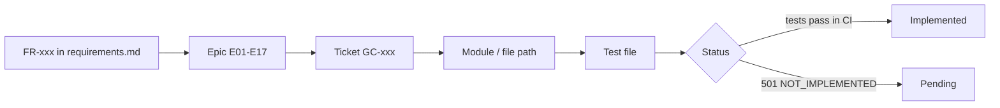

# Requirements Traceability Matrix

This matrix links every functional requirement in [requirements.md](requirements.md) to its epic and ticket(s) in [the backlog](../planning/backlog.md), the module(s) that implement it, and the tests that verify it.

- **Implemented** rows cite source files and test files that exist in the repository today. Test suites: `packages/shared/test/*.test.ts` (formula language, graph, engine), `apps/api/test/*.test.ts` (unit and integration against a real PostgreSQL database), `apps/web/test/*` (React Testing Library and logic tests).
- **Pending** rows name the intended location, marked "(planned)". Directories such as `apps/api/src/modules/imports/` do not exist yet; the API operation is already routed and answers `501 NOT_IMPLEMENTED` with the ticket (see `apps/api/src/modules/pending/pending.routes.ts`). The test column reads "planned".
- Epics follow the ticket's epic in the backlog. Story-level mapping is in [user-stories.md](user-stories.md).

## Summary

| Status      | FR range         |   Count |
| ----------- | ---------------- | ------: |
| Implemented | FR-001 to FR-050 |      50 |
| Pending     | FR-051 to FR-126 |      76 |
| **Total**   | FR-001 to FR-126 | **126** |

## Matrix

| FR     | Requirement (short)                                                                                            | Epic     | Ticket(s)      | Module / file path                                                                                                                                                                           | Test file(s)                                                                                                               | Status      |
| ------ | -------------------------------------------------------------------------------------------------------------- | -------- | -------------- | -------------------------------------------------------------------------------------------------------------------------------------------------------------------------------------------- | -------------------------------------------------------------------------------------------------------------------------- | ----------- |
| FR-001 | The system shall tokenize formulas into numbers, strings, booleans, error literals, cell references, ...       | E03      | GC-020         | `packages/shared/src/formula/tokenizer.ts`                                                                                                                                                   | `packages/shared/test/tokenizer.test.ts`                                                                                   | Implemented |
| FR-002 | The system shall support A1 references with optional `$` absolute markers and optional sheet prefixes, ...     | E03      | GC-020, GC-021 | `packages/shared/src/formula/tokenizer.ts`, `packages/shared/src/formula/references.ts`                                                                                                      | `packages/shared/test/tokenizer.test.ts`, `packages/shared/test/references.test.ts`, `packages/shared/test/parser.test.ts` | Implemented |
| FR-003 | The parser shall apply spreadsheet operator precedence: comparison < `&` < `+ -` < `* /` < `^` ...             | E03      | GC-021         | `packages/shared/src/formula/parser.ts`                                                                                                                                                      | `packages/shared/test/parser.test.ts`, `packages/shared/test/evaluator.test.ts`                                            | Implemented |
| FR-004 | The parser shall reject hostile or malformed formulas with bounded resources                                   | E03      | GC-020, GC-021 | `packages/shared/src/formula/tokenizer.ts`, `packages/shared/src/formula/parser.ts`                                                                                                          | `packages/shared/test/tokenizer.test.ts`, `packages/shared/test/parser.test.ts`                                            | Implemented |
| FR-005 | The system shall print an AST back to a canonical formula string                                               | E03      | GC-021         | `packages/shared/src/formula/printer.ts`                                                                                                                                                     | `packages/shared/test/parser.test.ts`                                                                                      | Implemented |
| FR-006 | The system shall classify raw cell input as empty, formula, text, number, boolean or error                     | E03      | GC-022         | `packages/shared/src/formula/cell-input.ts`                                                                                                                                                  | `packages/shared/test/cell-input.test.ts`, `packages/shared/test/recalc-engine.test.ts`                                    | Implemented |
| FR-007 | The evaluator shall coerce values between number, text and boolean following spreadsheet rules                 | E03      | GC-022         | `packages/shared/src/formula/coercion.ts`, `packages/shared/src/formula/evaluator.ts`                                                                                                        | `packages/shared/test/evaluator.test.ts`                                                                                   | Implemented |
| FR-008 | Comparison operators shall order numbers < text < booleans and compare text case-insensitively                 | E03      | GC-022         | `packages/shared/src/formula/coercion.ts`                                                                                                                                                    | `packages/shared/test/evaluator.test.ts`                                                                                   | Implemented |
| FR-009 | Error values shall propagate through operators and functions; the error set is `#DIV/0!`, `#VALUE!`, ...       | E03      | GC-022         | `packages/shared/src/formula/values.ts`, `packages/shared/src/formula/evaluator.ts`                                                                                                          | `packages/shared/test/evaluator.test.ts`, `packages/shared/test/functions.test.ts`                                         | Implemented |
| FR-010 | The evaluator shall evaluate ranges, passing bare cell references to functions as 1x1 ranges, and cap ...      | E03      | GC-022         | `packages/shared/src/formula/evaluator.ts`                                                                                                                                                   | `packages/shared/test/evaluator.test.ts`                                                                                   | Implemented |
| FR-011 | Numbers shall be displayed in General format with up to 15 significant digits, and subtraction results ...     | E03      | GC-022         | `packages/shared/src/formula/coercion.ts`, `packages/shared/src/formula/evaluator.ts`                                                                                                        | `packages/shared/test/evaluator.test.ts`                                                                                   | Implemented |
| FR-012 | The function library shall include math functions SUM, PRODUCT, MOD, POWER, PI, SUMIF, ABS, INT, SQRT, ...     | E03      | GC-023         | `packages/shared/src/formula/functions/math.ts`                                                                                                                                              | `packages/shared/test/functions.test.ts`                                                                                   | Implemented |
| FR-013 | The function library shall include statistical and counting functions AVERAGE, MIN, MAX, COUNT, COUNTA, ...    | E03      | GC-023         | `packages/shared/src/formula/functions/statistical.ts`                                                                                                                                       | `packages/shared/test/functions.test.ts`                                                                                   | Implemented |
| FR-014 | The function library shall include logical and information functions IF, IFERROR, AND, OR, NOT, ISBLANK, ...   | E03      | GC-023         | `packages/shared/src/formula/functions/logical.ts`                                                                                                                                           | `packages/shared/test/functions.test.ts`                                                                                   | Implemented |
| FR-015 | The function library shall include text functions CONCAT, CONCATENATE, LEFT, RIGHT, MID, LEN, UPPER, ...       | E03      | GC-023         | `packages/shared/src/formula/functions/text.ts`                                                                                                                                              | `packages/shared/test/functions.test.ts`                                                                                   | Implemented |
| FR-016 | The function library shall include lookup functions MATCH, VLOOKUP, HLOOKUP, INDEX, CHOOSE, with ...           | E03      | GC-023         | `packages/shared/src/formula/functions/lookup.ts`                                                                                                                                            | `packages/shared/test/functions.test.ts`                                                                                   | Implemented |
| FR-017 | Criteria arguments (SUMIF, COUNTIF) shall support comparison prefixes and wildcards `*`, `?` with `~` escape   | E03      | GC-023         | `packages/shared/src/formula/functions/criteria.ts`                                                                                                                                          | `packages/shared/test/criteria.test.ts`, `packages/shared/test/functions.test.ts`                                          | Implemented |
| FR-018 | The engine shall derive static, conservative precedents for each formula, including every branch of IF and ... | E04      | GC-030         | `packages/shared/src/formula/dependencies.ts`, `packages/shared/src/graph/dependency-graph.ts`                                                                                               | `packages/shared/test/dependency-graph.test.ts`, `packages/shared/test/recalc-engine.test.ts`                              | Implemented |
| FR-019 | The dependency graph shall index range precedents in column buckets, sending ranges wider than 64 columns ...  | E04      | GC-030         | `packages/shared/src/graph/range-index.ts`, `packages/shared/src/graph/dependency-graph.ts`                                                                                                  | `packages/shared/test/dependency-graph.test.ts`                                                                            | Implemented |
| FR-020 | After an edit, the engine shall recalculate only the dirty set: the edited formulas plus the transitive ...    | E04      | GC-031         | `packages/shared/src/engine/recalc-engine.ts`, `packages/shared/src/graph/dependency-graph.ts`                                                                                               | `packages/shared/test/recalc-engine.test.ts`, `packages/shared/test/dependency-graph.test.ts`                              | Implemented |
| FR-021 | The engine shall evaluate dirty formulas in dependency order using an iterative Tarjan SCC pass                | E04      | GC-031         | `packages/shared/src/graph/dependency-graph.ts`                                                                                                                                              | `packages/shared/test/dependency-graph.test.ts`                                                                            | Implemented |
| FR-022 | Cells participating in a cycle (SCC of size > 1, or a self-reference, including through a range) shall ...     | E04      | GC-031         | `packages/shared/src/graph/dependency-graph.ts`, `packages/shared/src/engine/recalc-engine.ts`                                                                                               | `packages/shared/test/recalc-engine.test.ts`, `packages/shared/test/dependency-graph.test.ts`                              | Implemented |
| FR-023 | Incremental recalculation shall produce exactly the same values as a full recalculation                        | E04      | GC-032         | `packages/shared/src/engine/recalc-engine.ts`                                                                                                                                                | `packages/shared/test/recalc-engine.test.ts`                                                                               | Implemented |
| FR-024 | Cross-sheet references shall resolve by sheet id; formulas naming a not-yet-existing sheet shall bind when ... | E04, E05 | GC-031, GC-041 | `packages/shared/src/engine/recalc-engine.ts`, `apps/api/src/modules/workbooks/workbook.service.ts`                                                                                          | `packages/shared/test/recalc-engine.test.ts`, `apps/api/test/workbooks.int.test.ts`                                        | Implemented |
| FR-025 | Users shall create, list and open workbooks in their organization; a new workbook has one default sheet        | E05      | GC-040, GC-041 | `apps/api/src/modules/workbooks/workbooks.routes.ts`, `apps/api/src/modules/workbooks/workbook.service.ts`, `apps/api/src/modules/workbooks/workbook.repository.ts`                          | `apps/api/test/workbooks.int.test.ts`                                                                                      | Implemented |
| FR-026 | Editors shall add sheets with unique (case-insensitive) names                                                  | E05      | GC-041         | `apps/api/src/modules/workbooks/workbook.service.ts`                                                                                                                                         | `apps/api/test/workbooks.int.test.ts`                                                                                      | Implemented |
| FR-027 | Clients shall read a rectangular window of cells with raw input and computed value                             | E05      | GC-041         | `apps/api/src/modules/workbooks/workbooks.routes.ts`, `apps/api/src/modules/workbooks/workbook.repository.ts`                                                                                | `apps/api/test/workbooks.int.test.ts`                                                                                      | Implemented |
| FR-028 | Editors shall submit batches of up to 1,000 cell edits atomically; the response includes the new revision ...  | E05      | GC-041         | `apps/api/src/modules/workbooks/workbook.service.ts`, `packages/shared/src/api/schemas.ts`                                                                                                   | `apps/api/test/workbooks.int.test.ts`, `packages/shared/test/schemas.test.ts`                                              | Implemented |
| FR-029 | Concurrent writes shall be serialized by a workbook row lock and a monotonic revision; stale writes are ...    | E05      | GC-041         | `apps/api/src/modules/workbooks/workbook.service.ts`                                                                                                                                         | `apps/api/test/workbooks.int.test.ts`                                                                                      | Implemented |
| FR-030 | The server shall keep recently used engines in an LRU cache valid only for the exact revision, rebuilding ...  | E05      | GC-041         | `apps/api/src/modules/workbooks/engine-cache.ts`                                                                                                                                             | `apps/api/test/unit.test.ts`, `apps/api/test/workbooks.int.test.ts`                                                        | Implemented |
| FR-031 | A workbook shall hold at most `MAX_CELLS_PER_WORKBOOK` non-empty cells (default 200,000)                       | E05      | GC-041         | `apps/api/src/modules/workbooks/workbook.service.ts`, `apps/api/src/config/env.ts`                                                                                                           | `apps/api/test/workbooks.int.test.ts`                                                                                      | Implemented |
| FR-032 | Every committed change shall append a row to `workbook_revisions` with actor, kind, edit count and ...         | E05      | GC-040         | `apps/api/migrations/0002_workbooks_and_cells.sql`, `apps/api/src/modules/workbooks/workbook.repository.ts`                                                                                  | `apps/api/test/workbooks.int.test.ts`                                                                                      | Implemented |
| FR-033 | The API shall expose the function catalog and a formula parse endpoint                                         | E05      | GC-042         | `apps/api/src/modules/formulas/formulas.routes.ts`, `packages/shared/src/formula/functions/registry.ts`                                                                                      | `apps/api/test/platform.int.test.ts`, `packages/shared/test/functions.test.ts`                                             | Implemented |
| FR-034 | A seed command shall create a demo organization and a calculated budget workbook idempotently                  | E05      | GC-052         | `apps/api/src/db/seed.ts`                                                                                                                                                                    | `apps/api/test/platform.int.test.ts`                                                                                       | Implemented |
| FR-035 | A visitor shall register an organization together with its owner account without revealing whether the ...     | E02      | GC-010         | `apps/api/src/modules/auth/auth.service.ts`, `apps/api/src/modules/auth/auth.routes.ts`                                                                                                      | `apps/api/test/auth.int.test.ts`                                                                                           | Implemented |
| FR-036 | Users shall sign in, read their session and sign out using a server-side session                               | E02      | GC-011         | `apps/api/src/modules/auth/auth.plugin.ts`, `apps/api/src/modules/auth/tokens.ts`, `apps/api/src/modules/auth/auth.repository.ts`                                                            | `apps/api/test/auth.int.test.ts`, `apps/api/test/unit.test.ts`                                                             | Implemented |
| FR-037 | Mutating requests shall require a CSRF token and an allowed Origin                                             | E02      | GC-011         | `apps/api/src/modules/auth/auth.plugin.ts`                                                                                                                                                   | `apps/api/test/auth.int.test.ts`                                                                                           | Implemented |
| FR-038 | Login shall be throttled per client IP and per email with progressive backoff                                  | E02      | GC-012         | `apps/api/src/modules/auth/login-throttle.ts`, `apps/api/src/modules/auth/rate-limiter.ts`, `apps/api/src/modules/auth/client-ip.ts`                                                         | `apps/api/test/unit.test.ts`, `apps/api/test/auth.int.test.ts`                                                             | Implemented |
| FR-039 | Access shall be governed by roles owner, admin, editor and viewer mapped to permissions                        | E02      | GC-013         | `apps/api/src/modules/rbac/permissions.ts`                                                                                                                                                   | `apps/api/test/unit.test.ts`, `apps/api/test/workbooks.int.test.ts`                                                        | Implemented |
| FR-040 | All workbook data shall be isolated per organization                                                           | E02, E05 | GC-013, GC-040 | `apps/api/src/modules/workbooks/workbook.repository.ts`                                                                                                                                      | `apps/api/test/workbooks.int.test.ts`                                                                                      | Implemented |
| FR-041 | Security-relevant and structural events shall be appended to `audit_events`                                    | E02      | GC-015         | `apps/api/src/modules/audit/audit.repository.ts`, `apps/api/migrations/0001_foundation.sql`                                                                                                  | `apps/api/test/auth.int.test.ts`, `apps/api/test/workbooks.int.test.ts`                                                    | Implemented |
| FR-042 | The API shall expose liveness and readiness probes                                                             | E01      | GC-005         | `apps/api/src/modules/health/health.routes.ts`                                                                                                                                               | `apps/api/test/platform.int.test.ts`                                                                                       | Implemented |
| FR-043 | All responses shall use the `{data, error}` envelope with stable error codes, and pending operations shall ... | E01      | GC-003         | `apps/api/src/http/envelope.ts`, `apps/api/src/http/error-handler.ts`, `apps/api/src/http/not-implemented.ts`, `apps/api/src/modules/pending/pending.routes.ts`                              | `apps/api/test/platform.int.test.ts`                                                                                       | Implemented |
| FR-044 | Database schema changes shall be applied by a forward-only migration runner with checksums and an advisory ... | E01      | GC-004         | `apps/api/src/db/migrate.ts`                                                                                                                                                                 | `apps/api/test/platform.int.test.ts`                                                                                       | Implemented |
| FR-045 | The web app shall provide login, registration, a workbooks list and navigation that shows planned sections ... | E06      | GC-050         | `apps/web/src/pages/LoginPage.tsx`, `apps/web/src/pages/RegisterPage.tsx`, `apps/web/src/pages/WorkbooksPage.tsx`, `apps/web/src/routes/navigation.ts`, `apps/web/src/pages/PendingPage.tsx` | `apps/web/test/components.test.tsx`, `apps/web/test/logic.test.ts`                                                         | Implemented |
| FR-046 | The grid shall render only the visible window of rows and columns                                              | E06      | GC-051         | `apps/web/src/pages/workbook/Grid.tsx`, `apps/web/src/pages/workbook/virtualization.ts`                                                                                                      | `apps/web/test/components.test.tsx`, `apps/web/test/logic.test.ts`                                                         | Implemented |
| FR-047 | A formula bar shall show the selected cell's raw input and error details and commit edits                      | E06      | GC-051         | `apps/web/src/pages/workbook/FormulaBar.tsx`, `apps/web/src/pages/workbook/cell-display.ts`                                                                                                  | `apps/web/test/components.test.tsx`, `apps/web/test/logic.test.ts`                                                         | Implemented |
| FR-048 | The grid shall support keyboard navigation and editing                                                         | E06      | GC-051         | `apps/web/src/pages/workbook/keyboard.ts`, `apps/web/src/pages/workbook/Grid.tsx`                                                                                                            | `apps/web/test/logic.test.ts`, `apps/web/test/components.test.tsx`                                                         | Implemented |
| FR-049 | Sheet tabs shall switch between sheets and add new sheets                                                      | E06      | GC-051         | `apps/web/src/pages/workbook/SheetTabs.tsx`, `apps/web/src/pages/workbook/WorkbookPage.tsx`                                                                                                  | `apps/web/test/components.test.tsx`                                                                                        | Implemented |
| FR-050 | Configuration shall be validated at startup and logs shall be structured with secret redaction                 | E01      | GC-002         | `apps/api/src/config/env.ts`, `apps/api/src/app.ts`                                                                                                                                          | `apps/api/test/unit.test.ts`                                                                                               | Implemented |
| FR-051 | Date and time functions on the serial-date system (DATE, TODAY, NOW, YEAR, MONTH, DAY, EDATE, EOMONTH, ...     | E03      | GC-024         | `packages/shared/src/formula/functions/date.ts` (planned)                                                                                                                                    | planned                                                                                                                    | Pending     |
| FR-052 | Lookup v2: XLOOKUP, XMATCH, SUMIFS, COUNTIFS, AVERAGEIFS, MAXIFS, MINIFS, SUMPRODUCT                           | E03      | GC-025         | `packages/shared/src/formula/functions/lookup.ts`, `packages/shared/src/formula/functions/statistical.ts` (planned)                                                                          | planned                                                                                                                    | Pending     |
| FR-053 | Text v2: TEXT, FIND, SEARCH, SUBSTITUTE, REPLACE, TEXTJOIN, VALUE, PROPER                                      | E03      | GC-026         | `packages/shared/src/formula/functions/text.ts` (planned)                                                                                                                                    | planned                                                                                                                    | Pending     |
| FR-054 | Math and statistics v2: MEDIAN, STDEV, VAR, RANK, LARGE, SMALL, LOG, EXP, trigonometric functions, RAND        | E03      | GC-027         | `packages/shared/src/formula/functions/math.ts`, `packages/shared/src/formula/functions/statistical.ts` (planned)                                                                            | planned                                                                                                                    | Pending     |
| FR-055 | Named ranges with workbook and sheet scope, bound in the parser and tracked as graph edges                     | E03      | GC-028         | `packages/shared/src/formula/parser.ts`, `packages/shared/src/engine/recalc-engine.ts`, `apps/api/src/modules/named-ranges/` (planned)                                                       | planned                                                                                                                    | Pending     |
| FR-056 | Whole-row and whole-column references (`A:A`, `1:1`) and 3D references (`Sheet1:Sheet3!A1`)                    | E03      | GC-029         | `packages/shared/src/formula/references.ts`, `packages/shared/src/graph/range-index.ts` (planned)                                                                                            | planned                                                                                                                    | Pending     |
| FR-057 | Volatile functions and dynamic references (INDIRECT, OFFSET) shall be scheduled for recalculation on every ... | E04      | GC-033         | `packages/shared/src/engine/recalc-engine.ts`, `packages/shared/src/graph/dependency-graph.ts` (planned)                                                                                     | planned                                                                                                                    | Pending     |
| FR-058 | Dynamic arrays: formulas returning arrays spill into neighbouring cells, with `#SPILL!` when blocked           | E03      | GC-034         | `packages/shared/src/engine/recalc-engine.ts`, `packages/shared/src/formula/evaluator.ts` (planned)                                                                                          | planned                                                                                                                    | Pending     |
| FR-059 | Formula autocomplete, signature help and reference highlighting in the editor                                  | E06      | GC-035         | `apps/web/src/pages/workbook/FormulaBar.tsx` (planned)                                                                                                                                       | planned                                                                                                                    | Pending     |
| FR-060 | Locale-aware formula input (decimal comma, semicolon argument separators) with canonical storage               | E03      | GC-036         | `packages/shared/src/formula/tokenizer.ts`, `apps/web/src/pages/workbook/FormulaBar.tsx` (planned)                                                                                           | planned                                                                                                                    | Pending     |
| FR-061 | Recalculation shall run in a worker thread with a time budget and cancellation                                 | E04      | GC-037         | `apps/api/src/modules/workbooks/engine-cache.ts`, `apps/api/src/modules/workbooks/recalc-worker.ts` (planned)                                                                                | planned                                                                                                                    | Pending     |
| FR-062 | Engine snapshots shall be persisted for fast cold start of large workbooks                                     | E04      | GC-038         | `apps/api/src/modules/workbooks/engine-snapshots.ts` (planned)                                                                                                                               | planned                                                                                                                    | Pending     |
| FR-063 | Range dependents shall be found through a 2D interval tree                                                     | E04      | GC-047         | `packages/shared/src/graph/range-index.ts` (planned)                                                                                                                                         | planned                                                                                                                    | Pending     |
| FR-064 | An opt-in iterative calculation mode shall resolve intentional cycles with max iterations and tolerance        | E04      | GC-048         | `packages/shared/src/engine/recalc-engine.ts` (planned)                                                                                                                                      | planned                                                                                                                    | Pending     |
| FR-065 | Users shall trace precedents and dependents of a cell, via API and grid arrows                                 | E04      | GC-049         | `apps/api/src/modules/workbooks/`, `apps/web/src/pages/workbook/Grid.tsx` (planned)                                                                                                          | planned                                                                                                                    | Pending     |
| FR-066 | Users shall rename, soft delete and duplicate workbooks                                                        | E05      | GC-043         | `apps/api/src/modules/workbooks/` (planned)                                                                                                                                                  | planned                                                                                                                    | Pending     |
| FR-067 | Users shall rename (rewriting formulas that mention the sheet), reorder, hide and delete sheets                | E05      | GC-044         | `apps/api/src/modules/workbooks/`, `packages/shared/src/formula/printer.ts` (planned)                                                                                                        | planned                                                                                                                    | Pending     |
| FR-068 | The workbooks list shall support search, sorting, pagination and a templates gallery                           | E05      | GC-045         | `apps/web/src/pages/WorkbooksPage.tsx`, `apps/api/src/modules/workbooks/` (planned)                                                                                                          | planned                                                                                                                    | Pending     |
| FR-069 | Users shall attach threaded comments to cells and resolve them                                                 | E05      | GC-046         | `apps/api/src/modules/comments/` (planned)                                                                                                                                                   | planned                                                                                                                    | Pending     |
| FR-070 | Users shall resize column widths and row heights, persisted per sheet                                          | E06      | GC-053         | `apps/web/src/pages/workbook/virtualization.ts`, `apps/api/src/modules/workbooks/` (planned)                                                                                                 | planned                                                                                                                    | Pending     |
| FR-071 | Users shall select ranges with Shift/Ctrl and Select All, and see sum, average and count of the selection      | E06      | GC-054         | `apps/web/src/pages/workbook/Grid.tsx` (planned)                                                                                                                                             | planned                                                                                                                    | Pending     |
| FR-072 | Users shall freeze rows and columns                                                                            | E06      | GC-055         | `apps/web/src/pages/workbook/Grid.tsx` (planned)                                                                                                                                             | planned                                                                                                                    | Pending     |
| FR-073 | A canvas renderer shall display million-row sheets                                                             | E06      | GC-056         | `apps/web/src/pages/workbook/` (planned)                                                                                                                                                     | planned                                                                                                                    | Pending     |
| FR-074 | Users shall find and replace across sheets                                                                     | E06      | GC-057         | `apps/api/src/modules/workbooks/`, `apps/web/src/pages/workbook/` (planned)                                                                                                                  | planned                                                                                                                    | Pending     |
| FR-075 | The grid shall expose ARIA grid semantics and announce cell changes to screen readers                          | E06      | GC-058         | `apps/web/src/pages/workbook/Grid.tsx` (planned)                                                                                                                                             | planned                                                                                                                    | Pending     |
| FR-076 | The grid shall offer a touch and small-screen editing layout                                                   | E06      | GC-059         | `apps/web/src/pages/workbook/` (planned)                                                                                                                                                     | planned                                                                                                                    | Pending     |
| FR-077 | Users shall insert and delete rows, with every formula reference rewritten and deleted references turned ...   | E07      | GC-060         | `packages/shared/src/formula/rewrite.ts`, `apps/api/src/modules/structure/` (planned)                                                                                                        | planned                                                                                                                    | Pending     |
| FR-078 | Users shall insert and delete columns with reference rewriting                                                 | E07      | GC-061         | `packages/shared/src/formula/rewrite.ts`, `apps/api/src/modules/structure/` (planned)                                                                                                        | planned                                                                                                                    | Pending     |
| FR-079 | Users shall move a range; formulas referencing it follow the move                                              | E07      | GC-062         | `packages/shared/src/formula/rewrite.ts`, `apps/api/src/modules/structure/` (planned)                                                                                                        | planned                                                                                                                    | Pending     |
| FR-080 | Users shall hide, unhide and group rows and columns                                                            | E07      | GC-063         | `apps/api/src/modules/structure/`, `apps/web/src/pages/workbook/Grid.tsx` (planned)                                                                                                          | planned                                                                                                                    | Pending     |
| FR-081 | Cells shall carry styles (font, fill, borders, alignment) stored as range runs                                 | E08      | GC-064         | `apps/api/src/modules/formats/` (planned)                                                                                                                                                    | planned                                                                                                                    | Pending     |
| FR-082 | A number format engine shall support custom codes, dates, percent and currency                                 | E08      | GC-065         | `packages/shared/src/format/number-format.ts` (planned)                                                                                                                                      | planned                                                                                                                    | Pending     |
| FR-083 | Users shall define conditional formatting rules                                                                | E08      | GC-066         | `apps/api/src/modules/formats/` (planned)                                                                                                                                                    | planned                                                                                                                    | Pending     |
| FR-084 | Users shall define data validation (lists, ranges, custom formula)                                             | E08      | GC-067         | `apps/api/src/modules/formats/` (planned)                                                                                                                                                    | planned                                                                                                                    | Pending     |
| FR-085 | Users shall merge and unmerge cells                                                                            | E08      | GC-068         | `apps/api/src/modules/formats/` (planned)                                                                                                                                                    | planned                                                                                                                    | Pending     |
| FR-086 | Every user action shall be a command with a server-computed inverse, supporting undo and redo                  | E09      | GC-070         | `apps/api/src/modules/commands/` (planned)                                                                                                                                                   | planned                                                                                                                    | Pending     |
| FR-087 | Copy and paste shall adjust relative references by the paste offset                                            | E09      | GC-071         | `packages/shared/src/formula/rewrite.ts`, `apps/api/src/modules/commands/` (planned)                                                                                                         | planned                                                                                                                    | Pending     |
| FR-088 | Paste special (values only, formats only, transpose) and external TSV/HTML clipboard shall be supported        | E09      | GC-072         | `apps/web/src/pages/workbook/clipboard.ts` (planned)                                                                                                                                         | planned                                                                                                                    | Pending     |
| FR-089 | A fill handle shall extend values and detect series                                                            | E09      | GC-073         | `apps/api/src/modules/commands/`, `apps/web/src/pages/workbook/` (planned)                                                                                                                   | planned                                                                                                                    | Pending     |
| FR-090 | Users shall sort a range by multiple keys with a stable order and formula adjustment                           | E10      | GC-074         | `apps/api/src/modules/sort-filter/` (planned)                                                                                                                                                | planned                                                                                                                    | Pending     |
| FR-091 | Users shall apply auto-filters with value and condition filters                                                | E10      | GC-075         | `apps/api/src/modules/sort-filter/` (planned)                                                                                                                                                | planned                                                                                                                    | Pending     |
| FR-092 | Users shall save per-user filter views that do not affect others                                               | E10      | GC-076         | `apps/api/src/modules/sort-filter/` (planned)                                                                                                                                                | planned                                                                                                                    | Pending     |
| FR-093 | A pivot engine shall aggregate a source range by row and column fields (sum, count, average, min, max)         | E11      | GC-077         | `packages/shared/src/pivot/`, `apps/api/src/modules/pivots/` (planned)                                                                                                                       | planned                                                                                                                    | Pending     |
| FR-094 | A pivot builder UI shall let users drag fields, refresh, and write output to a sheet                           | E11      | GC-078         | `apps/web/src/pages/pivots/`, `apps/api/src/modules/pivots/` (planned)                                                                                                                       | planned                                                                                                                    | Pending     |
| FR-095 | Pivots shall support date grouping, calculated fields and filters                                              | E11      | GC-079         | `packages/shared/src/pivot/` (planned)                                                                                                                                                       | planned                                                                                                                    | Pending     |
| FR-096 | Charts (bar, line, area, pie, scatter) shall render as SVG from ranges                                         | E12      | GC-080         | `apps/web/src/charts/`, `apps/api/src/modules/charts/` (planned)                                                                                                                             | planned                                                                                                                    | Pending     |
| FR-097 | A chart editor shall bind ranges live and set titles, axes and series                                          | E12      | GC-081         | `apps/web/src/charts/` (planned)                                                                                                                                                             | planned                                                                                                                    | Pending     |
| FR-098 | Charts shall export to SVG and PNG on the client                                                               | E12      | GC-082         | `apps/web/src/charts/` (planned)                                                                                                                                                             | planned                                                                                                                    | Pending     |
| FR-099 | Users shall import CSV with a streaming parser and delimiter and type inference                                | E13      | GC-083         | `apps/api/src/modules/imports/` (planned)                                                                                                                                                    | planned                                                                                                                    | Pending     |
| FR-100 | Users shall export a sheet as CSV                                                                              | E13      | GC-084         | `apps/api/src/modules/exports/` (planned)                                                                                                                                                    | planned                                                                                                                    | Pending     |
| FR-101 | Users shall import XLSX-lite files through an in-house zip/deflate reader and SpreadsheetML subset             | E13      | GC-085         | `apps/api/src/modules/imports/xlsx/` (planned)                                                                                                                                               | planned                                                                                                                    | Pending     |
| FR-102 | Users shall export XLSX-lite with values, formulas and basic styles                                            | E13      | GC-086         | `apps/api/src/modules/exports/xlsx/` (planned)                                                                                                                                               | planned                                                                                                                    | Pending     |
| FR-103 | Imports shall run as background jobs on a PostgreSQL `SKIP LOCKED` queue with status polling                   | E13      | GC-087         | `apps/api/src/modules/jobs/` (planned)                                                                                                                                                       | planned                                                                                                                    | Pending     |
| FR-104 | A WebSocket gateway shall authenticate with the session and join per-workbook rooms                            | E14      | GC-088         | `apps/api/src/modules/live/` (planned)                                                                                                                                                       | planned                                                                                                                    | Pending     |
| FR-105 | Concurrent edits shall merge at cell level with last-writer-wins and revision vectors                          | E14      | GC-089         | `apps/api/src/modules/live/`, `packages/shared/src/collab/` (planned)                                                                                                                        | planned                                                                                                                    | Pending     |
| FR-106 | Users shall see remote cursors, selections and avatars                                                         | E14      | GC-091         | `apps/api/src/modules/live/`, `apps/web/src/pages/workbook/` (planned)                                                                                                                       | planned                                                                                                                    | Pending     |
| FR-107 | Edits made offline shall queue and resynchronize on reconnect                                                  | E14      | GC-092         | `apps/web/src/pages/workbook/cell-store.ts` (planned)                                                                                                                                        | planned                                                                                                                    | Pending     |
| FR-108 | Revisions shall fan out across API instances via PostgreSQL LISTEN/NOTIFY                                      | E14      | GC-093         | `apps/api/src/modules/live/` (planned)                                                                                                                                                       | planned                                                                                                                    | Pending     |
| FR-109 | Users shall browse a version timeline built from the revision log                                              | E15      | GC-094         | `apps/api/src/modules/history/` (planned)                                                                                                                                                    | planned                                                                                                                    | Pending     |
| FR-110 | Users shall name versions and restore any version                                                              | E15      | GC-095         | `apps/api/src/modules/history/` (planned)                                                                                                                                                    | planned                                                                                                                    | Pending     |
| FR-111 | Users shall see who changed a cell and when                                                                    | E15      | GC-096         | `apps/api/src/modules/history/` (planned)                                                                                                                                                    | planned                                                                                                                    | Pending     |
| FR-112 | The revision log shall be compacted with periodic snapshots                                                    | E15      | GC-097         | `apps/api/src/modules/history/` (planned)                                                                                                                                                    | planned                                                                                                                    | Pending     |
| FR-113 | Workbook ACLs (owner, editor, commenter, viewer) shall override the organization role                          | E16      | GC-098         | `apps/api/src/modules/sharing/`, `apps/api/src/modules/rbac/permissions.ts` (planned)                                                                                                        | planned                                                                                                                    | Pending     |
| FR-114 | Owners shall create signed, revocable view-only share links                                                    | E16      | GC-099         | `apps/api/src/modules/sharing/` (planned)                                                                                                                                                    | planned                                                                                                                    | Pending     |
| FR-115 | Owners shall protect ranges and sheets from editing                                                            | E16      | GC-100         | `apps/api/src/modules/sharing/` (planned)                                                                                                                                                    | planned                                                                                                                    | Pending     |
| FR-116 | Sign-up shall be confirmed by an email verification message written to the local outbox, removing the ...      | E02      | GC-009         | `apps/api/src/modules/auth/`, `apps/api/src/modules/outbox/` (planned)                                                                                                                       | planned                                                                                                                    | Pending     |
| FR-117 | Users shall belong to multiple organizations and switch between them; owners edit organization settings        | E02      | GC-014         | `apps/api/src/modules/organizations/` (planned)                                                                                                                                              | planned                                                                                                                    | Pending     |
| FR-118 | Admins shall invite members by email through the outbox                                                        | E02      | GC-016         | `apps/api/src/modules/members/`, `apps/api/src/modules/outbox/` (planned)                                                                                                                    | planned                                                                                                                    | Pending     |
| FR-119 | Admins shall list members, change roles and remove members                                                     | E02      | GC-017         | `apps/api/src/modules/members/` (planned)                                                                                                                                                    | planned                                                                                                                    | Pending     |
| FR-120 | Users shall reset passwords via an outbox message, revoking existing sessions                                  | E02      | GC-018         | `apps/api/src/modules/auth/`, `apps/api/src/modules/outbox/` (planned)                                                                                                                       | planned                                                                                                                    | Pending     |
| FR-121 | Users shall list their active sessions and revoke devices                                                      | E02      | GC-019         | `apps/api/src/modules/auth/` (planned)                                                                                                                                                       | planned                                                                                                                    | Pending     |
| FR-122 | Admins shall search the audit log and export it as CSV                                                         | E02      | GC-090         | `apps/api/src/modules/audit/` (planned)                                                                                                                                                      | planned                                                                                                                    | Pending     |
| FR-123 | Login and registration throttle counters shall be shared across instances in PostgreSQL                        | E02      | GC-008         | `apps/api/src/modules/auth/login-throttle.ts` (planned)                                                                                                                                      | planned                                                                                                                    | Pending     |
| FR-124 | The API shall expose metrics in Prometheus text format, including recalculation latency histograms             | E17      | GC-101         | `apps/api/src/modules/metrics/` (planned)                                                                                                                                                    | planned                                                                                                                    | Pending     |
| FR-125 | Owners shall export all organization data and request deletion                                                 | E17      | GC-104         | `apps/api/src/modules/organizations/` (planned)                                                                                                                                              | planned                                                                                                                    | Pending     |
| FR-126 | Operators shall back up and restore the database with a scripted, rehearsed procedure                          | E17      | GC-103         | `run.sh` (planned)                                                                                                                                                                           | planned                                                                                                                    | Pending     |

## Non-functional requirement verification

| NFR     | Ticket(s)              | Verification                                                                                                                                                    | Status      |
| ------- | ---------------------- | --------------------------------------------------------------------------------------------------------------------------------------------------------------- | ----------- |
| NFR-001 | GC-102, GC-101         | Performance harness (planned)                                                                                                                                   | Pending     |
| NFR-002 | GC-102, GC-038         | Performance harness (planned)                                                                                                                                   | Pending     |
| NFR-003 | GC-031                 | `packages/shared/test/dependency-graph.test.ts` (100k chain)                                                                                                    | Implemented |
| NFR-004 | GC-102                 | Performance harness (planned)                                                                                                                                   | Pending     |
| NFR-005 | GC-051                 | `apps/web/test/components.test.tsx`, `apps/web/test/logic.test.ts`                                                                                              | Implemented |
| NFR-006 | GC-056                 | Browser performance trace (planned)                                                                                                                             | Pending     |
| NFR-007 | GC-041, GC-022, GC-003 | `apps/api/test/workbooks.int.test.ts`, `apps/api/test/platform.int.test.ts`, `packages/shared/test/evaluator.test.ts`, `packages/shared/test/tokenizer.test.ts` | Implemented |
| NFR-008 | GC-008, GC-093         | Multi-instance integration test (planned)                                                                                                                       | Pending     |
| NFR-009 | GC-011                 | `apps/api/test/unit.test.ts` (passwords and tokens)                                                                                                             | Implemented |
| NFR-010 | GC-011                 | `apps/api/test/auth.int.test.ts`                                                                                                                                | Implemented |
| NFR-011 | GC-012                 | `apps/api/test/unit.test.ts`, `apps/api/test/auth.int.test.ts`                                                                                                  | Implemented |
| NFR-012 | GC-013, GC-040         | `apps/api/test/workbooks.int.test.ts` (authorization and tenancy)                                                                                               | Implemented |
| NFR-013 | GC-003                 | `apps/api/test/platform.int.test.ts`                                                                                                                            | Implemented |
| NFR-014 | GC-106                 | CI gates (planned)                                                                                                                                              | Pending     |
| NFR-015 | GC-002, GC-021, GC-041 | `apps/api/test/workbooks.int.test.ts`, `apps/api/test/unit.test.ts`, `packages/shared/test/schemas.test.ts`, `packages/shared/test/parser.test.ts`              | Implemented |
| NFR-016 | GC-005                 | `apps/api/test/platform.int.test.ts`                                                                                                                            | Implemented |
| NFR-017 | GC-103                 | Restore drill (planned)                                                                                                                                         | Pending     |
| NFR-018 | GC-041                 | `apps/api/test/workbooks.int.test.ts`                                                                                                                           | Implemented |
| NFR-019 | GC-002, GC-003         | `apps/api/test/platform.int.test.ts` (request ids); redaction paths configured in `apps/api/src/app.ts` (no dedicated test yet)                                 | Implemented |
| NFR-020 | GC-101                 | Metrics scrape test (planned)                                                                                                                                   | Pending     |
| NFR-021 | GC-058                 | Accessibility audit (planned)                                                                                                                                   | Pending     |
| NFR-022 | GC-059, GC-105         | Cross-browser E2E (planned)                                                                                                                                     | Pending     |
| NFR-023 | GC-001                 | `npm run lint`, `format:check` and `typecheck` steps in `.github/workflows/ci.yml`                                                                              | Implemented |
| NFR-024 | GC-001, GC-032         | Coverage thresholds in `packages/shared/vitest.config.ts` and `apps/api/vitest.config.ts`                                                                       | Implemented |
| NFR-025 | GC-105                 | `e2e/tests/smoke.spec.ts` exists but is skipped in CI until GC-105                                                                                              | Pending     |
| NFR-026 | GC-006, GC-007         | `run.sh`, `.github/workflows/ci.yml`                                                                                                                            | Implemented |
| NFR-027 | GC-003, GC-009         | Code review; CSP check with GC-106                                                                                                                              | Implemented |
| NFR-028 | GC-022                 | `packages/shared/test/evaluator.test.ts` (formatGeneral)                                                                                                        | Implemented |
| NFR-029 | GC-104                 | Organization deletion test (planned)                                                                                                                            | Pending     |
