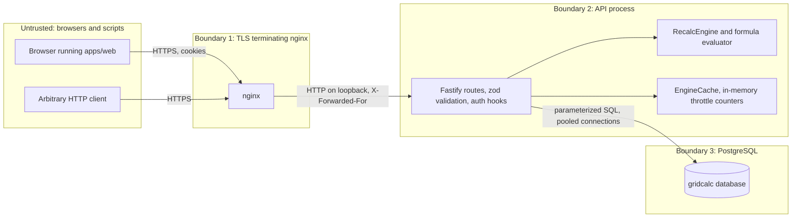

# Threat model

Scope: the gridcalc API (`apps/api`), the shared formula engine (`packages/shared`), the web client
(`apps/web`) and the PostgreSQL database, as deployed by [deployment.md](../operations/deployment.md).
Method: STRIDE per element, then a mapping to OWASP ASVS 4.0.3. The model is reviewed at every milestone
exit and whenever a trust boundary changes, for example when the WebSocket gateway (GC-088) or imports (GC-083/085) land.

## Assets

| Asset                                                    | Why it matters                                                                                 |
| -------------------------------------------------------- | ---------------------------------------------------------------------------------------------- |
| Workbook content (raw inputs, formulas, computed values) | Customer financial and operational data. Confidentiality and integrity are the top priorities. |
| Credentials (scrypt hashes) and session tokens           | Account takeover.                                                                              |
| Tenant boundary (`organization_id`)                      | One organization must never read or modify another's data.                                     |
| Revision log (`workbook_revisions`) and audit events     | Accountability and future version history.                                                     |
| Service availability                                     | A single hostile formula or request must not stall recalculation for everyone.                 |
| `SESSION_SECRET`, database credentials                   | Forging session ids, direct data access.                                                       |

## Trust boundaries

Formula text is user input that is **executed** by the engine. That makes the evaluator a boundary in its own
right, even though it runs inside the API process.

## STRIDE analysis

| #   | Element                        | Threat (STRIDE)                                                                      | Mitigation in code                                                                                                                                                                                                                    | Status      |
| --- | ------------------------------ | ------------------------------------------------------------------------------------ | ------------------------------------------------------------------------------------------------------------------------------------------------------------------------------------------------------------------------------------- | ----------- |
| S1  | Login                          | Spoofing via credential stuffing or password spraying                                | Per-IP window, cap of distinct emails per IP, per-email progressive backoff (30 s doubling to 1 h); attempts reserved before the hash is checked, so parallel requests cannot bypass the counter (`login-throttle.ts`)                | Implemented |
| S2  | Login                          | Spoofing the client IP through `X-Forwarded-For` to dodge throttles                  | `TRUST_PROXY` is `false`, a hop count, or a proxy list, never `true`; startup fails in production when it is unset (`config/env.ts`). IPs are normalized: IPv4-mapped IPv6 becomes IPv4, other IPv6 collapses to /64 (`client-ip.ts`) | Implemented |
| S3  | Session                        | Session theft through XSS                                                            | HttpOnly cookie, no token in `localStorage`, React escaping, API CSP `default-src 'none'`; web CSP pending (GC-106)                                                                                                                   | Partial     |
| S4  | Session                        | Stolen database dump reused as cookies                                               | DB stores `HMAC-SHA256(SESSION_SECRET, token)`, not the token                                                                                                                                                                         | Implemented |
| T1  | Mutating endpoints             | Cross-site request forgery                                                           | Per-session CSRF token in `x-csrf-token`, compared in constant time; `Origin` allow-list on all mutating requests; SameSite=Lax                                                                                                       | Implemented |
| T2  | Cell PATCH                     | Lost updates from concurrent writers                                                 | Workbook row lock and `baseRevision` check, `409 REVISION_CONFLICT`                                                                                                                                                                   | Implemented |
| T3  | Cell PATCH                     | Edits targeting a sheet in another workbook or organization                          | Sheet ids are checked against the locked workbook; every query filters by `organization_id`                                                                                                                                           | Implemented |
| T4  | Migrations                     | Tampering with an applied migration                                                  | SHA-256 checksums verified on every run                                                                                                                                                                                               | Implemented |
| R1  | All writes                     | Repudiation of changes                                                               | `audit_events` for registration, sessions, workbook and sheet creation; `workbook_revisions` records the actor and the edits of every commit. Audit search is pending (GC-090)                                                        | Partial     |
| I1  | Workbooks                      | Cross-tenant read through id guessing                                                | UUIDs, organization-scoped queries, 404 (not 403) for foreign ids                                                                                                                                                                     | Implemented |
| I2  | Registration                   | Account enumeration                                                                  | Generic `REGISTRATION_REJECTED` for existing emails, plus a per-IP registration limit. **Residual:** a 201 versus 400 still differs; GC-009 (email-verified sign-up through the local outbox) removes it                              | Partial     |
| I3  | Login                          | Enumeration through timing                                                           | Unknown emails are verified against a dummy scrypt hash; the error message is generic                                                                                                                                                 | Implemented |
| I4  | Logs                           | Secret leakage                                                                       | pino redacts `cookie`, `authorization`, `x-csrf-token` and `set-cookie`; passwords are never logged; 500 responses carry no internals                                                                                                 | Implemented |
| D1  | Parser                         | Stack exhaustion with deeply nested formulas                                         | `MAX_DEPTH = 64` nesting, `MAX_FORMULA_LENGTH = 8192`, `MAX_ARGS = 255` (`parser.ts`, `tokenizer.ts`)                                                                                                                                 | Implemented |
| D2  | Evaluator                      | Memory exhaustion with gigantic ranges (`A1:XFD1048576`)                             | `MAX_RANGE_CELLS = 2,000,000` returns `#NUM!` instead of materializing                                                                                                                                                                | Implemented |
| D3  | Recalc                         | Very long dependency chains overflowing the stack                                    | Iterative Tarjan and iterative BFS; covered by a 100k-chain test                                                                                                                                                                      | Implemented |
| D4  | Recalc                         | Cycle bombs (large strongly connected components)                                    | Cycles are found in O(V+E) and each member is set to `#CYCLE!` once, with no iteration. Iterative calculation (GC-048) will carry hard iteration and epsilon caps                                                                     | Implemented |
| D5  | Recalc                         | A single huge batch monopolizing the event loop                                      | 1,000 edits per request, 200k cells per workbook, 4 MiB body limit. Worker-thread recalc with a time budget is pending (GC-037)                                                                                                       | Partial     |
| D6  | Criteria (`COUNTIF` wildcards) | ReDoS through crafted patterns                                                       | Wildcards compile to a regex that contains only literals, `[\s\S]` and `[\s\S]*` with every other character escaped, anchored, and bounded by the 8,192-character input limit. A linear-time matcher is planned with GC-025           | Partial     |
| D7  | Throttle store                 | Attacker fills the bounded counter store to evict real lockouts or lock everyone out | Store is bounded; a resumable sweep drops expired entries first; when every entry is active, the one with the least time left is evicted and a warning is logged; distinct emails per IP are capped                                   | Implemented |
| E1  | RBAC                           | Viewer performing writes                                                             | `requirePermission` preHandlers on every route; role-to-permission map in `rbac/permissions.ts`; covered by tests                                                                                                                     | Implemented |
| E2  | Future export                  | Formula/CSV injection when exported files are opened elsewhere (`=HYPERLINK(...)`)   | Export (GC-084/086) will prefix cells starting with `= + - @` with an apostrophe in CSV mode                                                                                                                                          | Planned     |
| E3  | Future imports                 | Zip bombs and XML entity expansion in XLSX-lite                                      | In-house reader (GC-085) with an uncompressed-size cap, entry-count cap, and no DTD processing                                                                                                                                        | Planned     |

## Deployment constraint: single API instance

Login and registration counters (`LoginThrottle`, `FixedWindowRateLimiter`) and the `EngineCache` live **in process memory**.

- The engine cache is safe across instances: an entry is used only when its revision equals the locked database revision.
- The throttle counters are **not** shared. With N instances behind a load balancer, an attacker gets N times the budget.
  **The counters must move to PostgreSQL (GC-008) before more than one API instance runs.** Until then,
  deployment.md requires a single instance.

## Residual risks

| Risk                                                  | Accepted until                        |
| ----------------------------------------------------- | ------------------------------------- |
| Registration status code reveals that an email exists | GC-009 (M7)                           |
| No web-page CSP or Subresource Integrity on the SPA   | GC-106 (M9)                           |
| Throttling is per instance only                       | GC-008 (M9); enforced single instance |
| Recalculation runs on the request thread              | GC-037 (M6)                           |
| No MFA                                                | Backlog candidate after M7            |

## OWASP ASVS 4.0.3 mapping

| ASVS     | Requirement (abridged)                        | gridcalc control                                                    | Status                |
| -------- | --------------------------------------------- | ------------------------------------------------------------------- | --------------------- |
| V1.4.1   | Trusted enforcement points for access control | Fastify preHandlers plus repository-level `organization_id` filters | Met                   |
| V2.1.1   | Passwords of at least 12 characters           | `passwordSchema` minimum 12                                         | Met                   |
| V2.2.1   | Anti-automation against credential stuffing   | Multi-key throttling (S1, S2, D7)                                   | Met (single instance) |
| V2.4.1   | Passwords stored with an approved KDF         | scrypt N=16384, r=8, p=1, 16-byte salt                              | Met                   |
| V2.5.2   | No password hints or knowledge-based answers  | None exist                                                          | Met                   |
| V3.2.1   | New session token on authentication           | Fresh 256-bit token per login and registration                      | Met                   |
| V3.3.1   | Logout invalidates the session                | Session row deleted, cookies cleared                                | Met                   |
| V3.4.1-3 | Cookie Secure, HttpOnly, SameSite             | Secure (prod), HttpOnly, SameSite=Lax                               | Met                   |
| V3.5.3   | Stateless tokens protected                    | No JWT used (ADR-0014)                                              | N/A                   |
| V4.1.3   | Least privilege                               | Four roles, viewer read-only                                        | Met                   |
| V4.2.1   | Protection against IDOR                       | Tenant-scoped queries, 404 for foreign ids                          | Met                   |
| V4.2.2   | Anti-CSRF                                     | Token plus Origin check                                             | Met                   |
| V5.1.3   | Positive input validation                     | zod schemas, bounded sizes                                          | Met                   |
| V5.3.4   | Parameterized queries                         | `pg` placeholders and `unnest` arrays only                          | Met                   |
| V5.3.10  | Spreadsheet export injection                  | Planned escaping in export (E2)                                     | Planned               |
| V7.1.1   | No credentials or session tokens in logs      | pino redaction                                                      | Met                   |
| V7.4.1   | Generic error messages                        | Central error handler                                               | Met                   |
| V8.3.4   | Sensitive data inventory                      | Assets table above                                                  | Met                   |
| V9.1.1   | TLS for all client traffic                    | nginx TLS (deployment.md)                                           | Met by deployment     |
| V11.1.4  | Anti-automation on business functions         | Edit batch and workbook size limits                                 | Partial               |
| V12.1.1  | Upload size limits                            | Body limit; import limits planned (E3)                              | Partial               |
| V14.2.1  | Dependency checks                             | Lean dependency list; audit gate in CI pending (GC-106)             | Partial               |
| V14.4.3  | Content-Security-Policy                       | API CSP set; SPA CSP pending                                        | Partial               |
