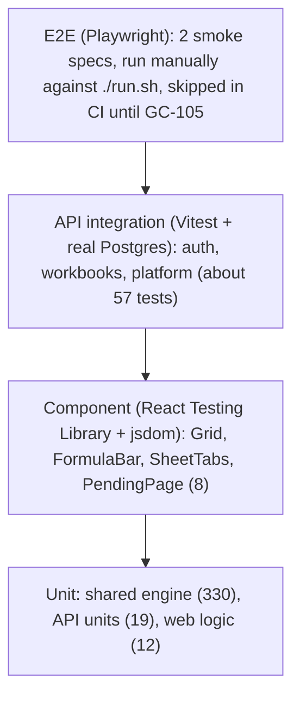

# Test strategy

## Goals

1. **Correctness of the formula engine.** The parser, evaluator and recalculation engine are the product. They get the densest testing, including randomized property tests.
2. **Real infrastructure for integration.** API tests run against a real PostgreSQL database, never mocks or containers, so locking, constraints and SQL behave as in production.
3. **Fast feedback.** The full suite of about 426 tests runs in under 15 seconds locally and in CI.
4. **Coverage as a floor, not a goal.** Thresholds are enforced on implemented code only. Pending modules (501 handlers) are exercised by a route-sweep test.

## Test pyramid



## What is tested where

| Area                 | Files                                                              | Highlights                                                                                                                                                                                                                                  |
| -------------------- | ------------------------------------------------------------------ | ------------------------------------------------------------------------------------------------------------------------------------------------------------------------------------------------------------------------------------------- |
| A1 references        | `packages/shared/test/references.test.ts`                          | Column letters round-trip for 2,000 columns; bounds `XFD1048576`; absolute markers                                                                                                                                                          |
| Tokenizer            | `packages/shared/test/tokenizer.test.ts`                           | Number shapes, escaped strings, quoted sheet names, greedy operators, error literals, positions, length cap                                                                                                                                 |
| Parser and printer   | `packages/shared/test/parser.test.ts`                              | Precedence table (`-2^2`, `2^3^2`, `%`), ranges, omitted arguments, error messages with positions, depth and arity limits, print/parse round-trip                                                                                           |
| Evaluator            | `packages/shared/test/evaluator.test.ts`                           | Arithmetic, coercion, comparison ordering, error propagation order, cross-sheet references, range materialization limit, `formatGeneral`                                                                                                    |
| Functions            | `packages/shared/test/functions.test.ts`                           | Every one of the 43 functions with normal, edge and error cases; lazy evaluation of `IF`/`CHOOSE`; registry invariants                                                                                                                      |
| Criteria             | `packages/shared/test/criteria.test.ts`                            | Operators, wildcards and escapes, blank and non-blank, numeric text                                                                                                                                                                         |
| Cell input           | `packages/shared/test/cell-input.test.ts`                          | Raw-input classification, syntax error offsets, DTO conversion                                                                                                                                                                              |
| Dependency graph     | `packages/shared/test/dependency-graph.test.ts`                    | Cell and range dependents, wide ranges, dirty closure, diamond ordering, cycles and self-loops, **100,000-long chain** without stack overflow                                                                                               |
| Recalc engine        | `packages/shared/test/recalc-engine.test.ts`                       | Incremental dirty sets, changed-cell reporting, cross-sheet propagation, cycle entry and recovery, deferred sheet binding, **randomized equivalence**                                                                                       |
| Schemas              | `packages/shared/test/schemas.test.ts`                             | Registration, sheet names, edit batch bounds                                                                                                                                                                                                |
| API units            | `apps/api/test/unit.test.ts`                                       | Config validation (including `TRUST_PROXY` and production rules), scrypt, tokens, rate limiter, `LoginThrottle` (reservation, backoff, store bounding, per-IP email cap), IP normalization, RBAC, engine cache LRU                          |
| Auth integration     | `apps/api/test/auth.int.test.ts`                                   | Register, login, me, logout; CSRF; Origin; expired and forged sessions; non-enumerating registration; per-email backoff across IPs; **parallel bad logins**; spraying; `X-Forwarded-For` ignored unless trusted                             |
| Workbook integration | `apps/api/test/workbooks.int.test.ts`                              | Create and list; PATCH recalculation; changed-cell sets; errors and cycles persisted; **409 conflicts**; **5 concurrent writers, exactly one wins**; stale engine-cache rebuild; cell limit; deferred sheet binding; RBAC; tenant isolation |
| Platform integration | `apps/api/test/platform.int.test.ts`                               | Health and readiness (including DB down), envelope mapping, **every pending route returns 501 with its ticket**, formula endpoints, migration idempotency, checksum tampering, failed-migration rollback, seed                              |
| Web                  | `apps/web/test/logic.test.ts`, `apps/web/test/components.test.tsx` | Virtualization math, keyboard rules, cell display, immutable cell store, API client (CSRF header, typed errors); Grid renders fewer than 200 cells for a 100k-row sheet and re-windows on scroll                                            |
| E2E                  | `e2e/tests/smoke.spec.ts`                                          | Sign in, edit a seeded cell, observe the dependent total change; planned section badge                                                                                                                                                      |

## Property-based equivalence test

`recalc-engine.test.ts` runs 25 seeds of a deterministic linear congruential generator. Each seed applies 60
random edit batches over a 6x4 grid on two sheets. Edits mix constants, arithmetic, `SUM` ranges, `IF`,
cross-sheet references, division (errors) and `IFERROR`, and frequently create and break cycles. After
**every** batch the incrementally maintained engine is compared cell by cell with a fresh engine that performs a
full calculation from the same raw inputs. Any missed dependency, ordering bug or stale cycle marker fails the test
with a reproducible seed. That is 1,500 comparisons per run.

## Coverage thresholds

| Package           |    Lines | Functions | Branches | Statements | Config                             |
| ----------------- | -------: | --------: | -------: | ---------: | ---------------------------------- |
| `packages/shared` |       90 |        90 |       85 |         90 | `packages/shared/vitest.config.ts` |
| `apps/api`        |       85 |        85 |       75 |         85 | `apps/api/vitest.config.ts`        |
| `apps/web`        | reported |           |          |            | `apps/web/vite.config.ts`          |

Current results: shared about 99.6% lines, API about 99% lines. Bootstrap code (`src/index.ts`, `src/db/cli.ts`) is excluded.

## Running tests

```bash
./run.sh test                    # lint, format check, typecheck, all tests (creates gridcalc_test if needed)
npm test                         # all workspaces
npm run test:coverage            # with thresholds
npm test -w @gridcalc/shared     # engine only (no database needed)
TEST_DATABASE_URL=postgres:///gridcalc_test?host=/tmp npm test -w @gridcalc/api
npx playwright install chromium && ./run.sh & npm run test:e2e
```

The API suite's global setup (`apps/api/test/global-setup.ts`) drops and recreates the `public` schema of the
**test** database and applies all migrations, so runs are hermetic. Files run sequentially (`fileParallelism: false`)
because they share that schema. Each test registers its own organization with unique emails, so tests do not depend on each other.

## CI

`.github/workflows/ci.yml` starts the runner's preinstalled PostgreSQL with `systemctl`, creates a role and the
`gridcalc_test` database, then runs `lint`, `format:check`, `typecheck`, `test:coverage` and `build`. No containers
are used. E2E specs skip themselves when `CI` is set until browser caching lands (GC-105).

## Acceptance test matrix

| Capability                                      |                                 Unit                                 | Component |           Integration           |   E2E   | Status      |
| ----------------------------------------------- | :------------------------------------------------------------------: | :-------: | :-----------------------------: | :-----: | ----------- |
| Formula parsing and evaluation (43 functions)   |                                 yes                                  |           |      yes (parse endpoint)       |         | Implemented |
| Incremental recalc and cycle detection          |                            yes (property)                            |           |               yes               |   yes   | Implemented |
| Cell batch editing with revisions and conflicts |                                                                      |           |               yes               |   yes   | Implemented |
| Deferred sheet binding                          |                                 yes                                  |           |               yes               |         | Implemented |
| Auth, CSRF, throttling, RBAC, tenancy           |                                 yes                                  |           |               yes               |   yes   | Implemented |
| Virtualized grid and keyboard editing           |                                 yes                                  |    yes    |                                 |   yes   | Implemented |
| Pending endpoint contract (501 plus ticket)     |                                                                      |           |               yes               |         | Implemented |
| Named ranges, date functions (M2)               |                               planned                                |           |             planned             |         | Pending     |
| Row/column insert with reference rewriting (M3) | planned (property: rewrite then evaluate equals evaluate then shift) |           |             planned             | planned | Pending     |
| Undo/redo and copy/paste (M4)                   |                    planned (inverse-op property)                     |  planned  |             planned             | planned | Pending     |
| Import/export round-trip (M5)                   |                         planned (fuzzed CSV)                         |           |             planned             |         | Pending     |
| Collaboration convergence (M6)                  |               planned (randomized concurrent replicas)               |           | planned (two WebSocket clients) | planned | Pending     |
| Version restore (M7)                            |                                                                      |           |             planned             | planned | Pending     |
| Pivots and charts (M8)                          |                               planned                                |  planned  |             planned             | planned | Pending     |
| Performance budgets (M9)                        |                                                                      |           |     planned harness GC-102      |         | Pending     |
